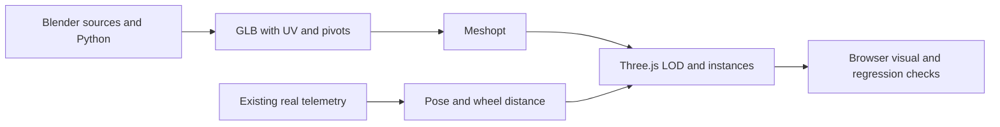

# V4 art source and export

## Current V7 vehicle

`npm run assets:build` runs `build_v7.py` and the optimizer's `--cars-only` mode. It updates only the three `assets/v4/car-*.glb` files (stable runtime URLs), their manifest/provenance and `vehicle-v7-authoring.json`. The original, unbranded V7 design and its 2022–2025-style open-wheel proportions are not a verified team replica. `vehicle-v7.blend` is the editable high-detail source, actually reopened in Blender 4.3.2. V4 helper functions are imported without rebuilding the venue.

Retained contract: metres, +Z forward, Y up on export, 3.32 m wheelbase, 0.36 m tyre radius and original `Wheel_*` / `Steer_F*` pivots. Front/rear carcass widths are 0.35/0.39 m. Wheels spin from replay distance; front steering remains the existing visual approximation. Chassis, wishbones and uprights follow the same rigid surface pose: no independent suspension travel, tyre deformation or suspension physics is claimed.

V7 changes the undercut sidepod sections, recessed intake, nose/engine-cover taper, wraparound visor, joined diffuser ramp, tyre shoulder/rim details and bounded PBR values. Invisible rotors behind closed covers are omitted. Shared procedural carbon color texture stays 64×64; no new external models, textures or shader passes are introduced. High/medium/low keep the same wheel support dimensions; subdivision and rotational sampling vary. GPU FPS remains unverified here; V6.1's NVIDIA acceptance debt is separate.

The following V4 reconstruction notes remain available. `npm run assets:build:v4` explicitly rebuilds the historical V4 vehicle **and venue**; it replaces the current vehicle output and is not the V7 vehicle workflow.

Blender **4.3.2** was actually run in this environment. `vehicle-v4.blend`, `venue-v4.blend` and `tree-v4.blend` are editable source files, not renamed glTFs. Metres; authoring uses Blender Z up, exports use glTF Y up / +Z forward. Modifiers are applied on export, while the Python authoring script recreates the modifier workflow. Vehicle and venue are original, unbranded designs; they are not official team or surveyed circuit models.

## Rebuild original vehicle and venue

From the repository root:

```sh
npm ci
blender -b --threads 2 --python art/blender/build_v4.py
node scripts/optimize-v4.mjs
```

The `.blend` files are saved compressed. The venue source arranges reusable assets side-by-side for editing; export returns each prefab to its local origin. Pivots `Wheel_*` / `Steer_F*` are retained. Joining is restricted to a single material inside a pivot; moving groups are not flattened. High/medium/low use different surface subdivision and rotational sampling. Authored UVs, bevelled manufactured edges and weighted normals are exported. Node optimization uses dedup/weld, 16-bit normals/positions and Meshopt, without changing the animation hierarchy. Runtime animation selects empty pivots only, avoiding a second rotation of meshes with similar names.

If the optional tree raw export is absent, the optimizer reuses the committed final tree GLB. Normal app use requires no Blender/build step: the final GLBs and maps are committed. `*-raw.glb` and `.blend1` backups are build outputs and excluded from Git.

## Licensed artist tree and impostors

[Tree Small 02](https://polyhaven.com/a/tree_small_02), **Rico Cilliers, CC0 1.0**, supplies the detailed tree. It is a Geometry Nodes artist asset, not a Mexico scan. The OSM map supplies tree positions, not confirmed species. Source URLs and download MD5 values are in `tree-source.json`; the original ~95 MB glTF buffer is not redistributed in this repo.

```sh
python3 scripts/fetch-tree-v4.py /tmp/td-v4-tree
blender -b --threads 3 --python art/blender/prepare_tree.py -- /tmp/td-v4-tree/tree_small_02.gltf
python3 scripts/pack-tree-atlas.py
node scripts/optimize-v4.mjs
```

Preparation scales the tree to a representative 7 m, makes a decimated near model, reduces shared maps to 512 px, and creates **three real Cycles CPU renders** (front, side, top, 512×512, 24 samples, transparent background). OpenImageDenoise is unavailable in the installed Blender build, so denoising is disabled. The 1536×512 atlas reconstructs foliage for distant and overhead views; the near model adds depth. This is a standard impostor compromise: fixed baked lighting, flat-card/parallax artifacts, and visible LOD changes remain. No claim of a fully volumetric leaf canopy at every distance.

## Materials

Original road microaggregate maps: `python3 scripts/materials-v4.py` (NumPy/Pillow). Includes a seamless palette derivative of the CC0 soil texture for turf. Concrete Floor 02 / Brown Mud Leaves 01 are CC0 Rob Tuytel assets. Daylight HDRI is Kloofendal 48d Partly Cloudy PureSky, CC0 Greg Zaal / Jarod Guest. Original URLs/hashes/modifications: `assets/v4/sources.json`; CC0 license copy remains `assets/licenses/CC0-1.0.txt`.

Road KTX2: Basis Universal encoder v1.15, UASTC + mipmaps; use linear mode for normal/roughness, sRGB for base color. JPEG fallbacks are kept. Close prefabs share materials and geometry; repeated items use regional GPU instancing. Window/metal/cockpit/tyre surfaces use bounded PBR parameters rather than unsupported Blender procedural shader nodes. Far skyline is representative race atmosphere, not measured city geometry.

The stadium staircase module is fitted to the two mapped main seating footprints; surrounding seat/crowd instances are compacted to leave real visible corridors. The slope follows the same explicitly representative stand rise, not an architectural measurement. Near tree LOD selection is per instance (Ultra 75 m, Balanced 45 m); the 160 m cells are batching units, not an excuse to draw a whole cell at the highest tree detail.

For recording only: install the pinned Playwright FFmpeg helper with `PLAYWRIGHT_BROWSERS_PATH=/path/to/cache npx playwright install ffmpeg`, then use the same environment variable with `node scripts/record-v4.cjs http://localhost:4173 docs/visual/v4`. A system FFmpeg executable trims the loading section without speeding up the recording.



Blender yinelenen materyallere `.001` gibi ekler verir. Çalışma zamanı bu ekleri normalize eder; tarayıcı testi her araç LOD’unda karbon ve çevre betonunun gerçek PBR harita atamalarını denetler.
