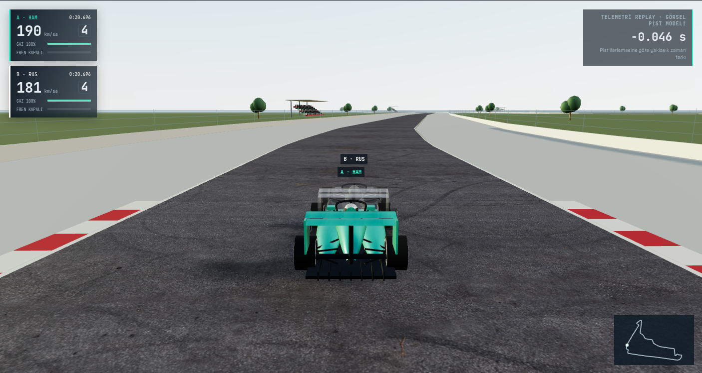
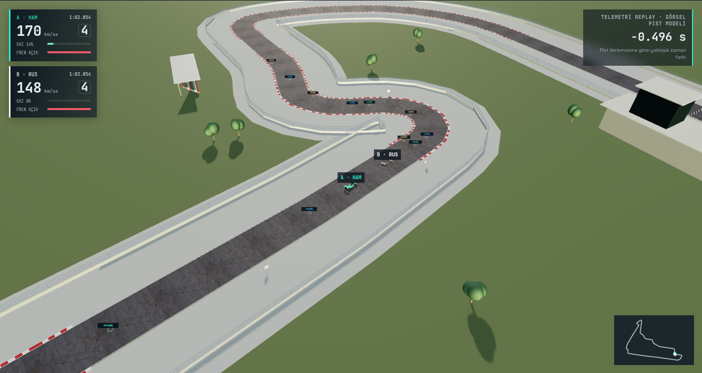

# Görsel geliştirme V2 — kapsam ve doğruluk sınırları

Bu sürüm, referans incelemesindeki A/B/C işlerini mevcut HTML/JavaScript/Three.js yapısı içinde uygular. Unity, Unreal, Nuxt veya başka framework'e geçilmedi. Referans Instagram bağlantısı Antonelli–Verstappen / COTA kaydıdır; buradaki varsayılan gerçek veri 2024 HAM/RUS Meksika sıralamadır. Referansın takım logoları, kaplamaları veya görüntüleri uygulamaya kopyalanmadı.

| İş | Uygulanan sistem | Sınır |
|---|---|---|
| A0 | Kare aralığını kırpmayan saat, eski hızdaki süreyi hesaba katan hız değişimi, gizlenen sekmede açık duraklatma; coğrafi pist ilerlemesi ve başarısız hizalamada normalize mesafe yedeği | Kaynak örneklerden daha hassas ölçüm üretmez; gerçek GPS konumunda eşit mesafe iddiası yok |
| A1 | Projeye özgü yeni GLB araç, Meshopt sıkıştırma, üç LOD, ayrı tekerlek/direksiyon düğümleri, PBR/clearcoat, yedek model | Özgün, genel açık tekerlekli tasarım; lisanslı gerçek Mercedes/Red Bull modeline veya fotogerçekçi kaliteye eşdeğer değil |
| A2 | MIT lisanslı sabit Meksika coğrafi çizgisi; fiziksel yol mesh'i pilot/turdan bağımsız; iki turdan türetilen ortalama yol yerine sabit referans | Kaynak bir 3D pist taraması değil; genişlik 14 m, kerbler, düz zemin ve yapılar temsili |
| A3 | CC0 gerçek asfalt base-color/normal/roughness, metre ölçekli UV, mipmap ve KTX2; JPEG yedeği | Pistte çekilmiş özel Meksika asfaltı değildir; görsel yüzeydir |
| B1 | CC0 HDRI yansıma ortamı, atmosferik Sky, uyumlu yönlü ışık, profilli gölge haritaları ve hafif temas gölgesi | Gerçek yarış gününün güneş/hava rekonstrüksiyonu değil |
| B2 | Dururken de yumuşak kamera geçişi, engel kontrolü, serbest kamerada pan/WASD/R, sahne içi pilot HUD'u, tam ekran; HUD ve mini harita daha düşük frekansta güncellenir | Mekânsal kamera engel kontrolü yaklaşık üçgen kesişimidir; tüm pistlerde her açı denenmedi |
| B3 | Temsili pit binası, kontrol kulesi, stadyum tribünleri, ağaç kümeleri, çizgiler ve tabelalar | Yapıların mimarisi/yerleşimi doğrulanmış model değil |
| C1 | Meshopt GLB, KTX2 UASTC, LOD, mekânsal çevre parçaları, profil bazlı görüş uzaklığı, ortak varlık havuzu ve kaynak temizliği | KTX2 indirme dosyası JPEG'den büyük olabilir; hedef GPU formatı cihaz desteğine bağlı |
| C2 | Yalnız Ultra'da isteğe bağlı SSAO + OutputPass; açılmadığında post-processing hattı kullanılmaz | Ağır motion blur, SSR ve ray tracing eklenmedi; önerilen kapsam sınırlı AO idi |

## Veri ve zaman

`src/replay-core.js` saf fonksiyonları Node ve tarayıcıdan kullanılır. `advance` geçen süreyi 100 ms'ye kırpmaz. `changeRate` önce eski hızdaki süreyi işler. Sekme gizlenirse yeniden açılışta otomatik devam etmeden duraklar; görünmeyen sekmenin zamanı sessizce atlanmaz.

Meksika çizgisi yerel metre koordinatlarına çevrilir ve kaynağın bildirdiği 4304 m istasyon uzunluğuna ölçeklenir. Bu uzunluk bağımsız bir ölçümümüz değildir. Benzerlik dönüşümü konum örneklerini referansa hizalar; birim, yansıma, yön ve başlangıç fazı değerlendirilir. Örnekler yakın segmentlere projekte edilir, geçişlerde yakın istasyon tercihi uygulanır. Büyük sapma, geri hareket veya eksik tur saptanırsa `valid=false` olur ve önceki normalize mesafe yöntemi kullanılır. Özgün kaynak dizilerinin değerleri değiştirilmez.

Projeksiyonla bulunan ilerleme, turun başlangıç ve bitişine göre 0–1'e normalize edilir. Dolayısıyla delta **yaklaşık ortak pist ilerlemesinde** B.t − A.t'dir. Bağımsız hassas GPS eşlemesi veya milisaniye seviyesinde fiziksel konum doğruluğu değildir. Tam tur farkı kaynak tur sürelerinden korunur. Başlangıç/bitiş koordinatlarının örnekleme sapmaları ve coğrafi çizginin hatası kalır. Ölçüm raporunda hizalama RMSE ve azami konum sapması izlenir.

Aracın tekerlek dönüşü, station/projeksiyondan değil özgün telemetri mesafesinden hesaplanır. Direksiyon görünümü eğriden türetilen kozmetik tahmindir; ölçülmüş direksiyon açısı değildir. Varsayılan ortak sürüş çizgisi de tahmin olarak etiketlenmeye devam eder.

## Görsel kaynak yaşam döngüsü

`src/visual-assets.js` GLB şablonlarını ve dokuları havuzda tutar. Düşük/orta LOD ilk yüklemede, yüksek LOD Ultra gerektiğinde yüklenir. Araçların materyalleri ayrıdır; geometri ortaktır. Tur değişiminde sahne materyalleri ve özgün geometriler temizlenirken ortak varlık geometrileri korunur. Sayfa çıkışında havuz, PMREM, shader pass'leri, GPU sorguları ve renderer temizlenir.

Çevre materyalleri 180 m mekânsal hücreler içinde birleştirilir; tüm pisti kaplayan tek mesh'e dönüştürülmez. Profil ve kamera konumu görünür hücreleri sınırlar. Adaptif çözünürlük değişikliği bir sonraki çizimden **önce** uygulanır; çizimden sonra canvas yeniden boyutlandırılmaz.

## Profiller

- **Performans:** düşük araç LOD'u, kapalı gerçek gölge haritası/AO, kısıtlı çevre uzaklığı, azaltılmış render ölçeği; normal/roughness haritası örneklemesi sadeleştirilir.
- **Dengeli:** yakın araçta orta LOD, 1024 gölge, orta çevre uzaklığı; varsayılan.
- **Ultra:** yakında yüksek LOD, 2048 gölge, daha uzun çevre uzaklığı; isteğe bağlı AO.

Kalite değişimi tur saatini veya telemetriyi sıfırlamaz. Grafik profili yükleme/shader derlemesi sırasında ilk kullanım takılması yine mümkün olabilir. Dinamik çözünürlük kapatılıp gerçek render boyutu ve ölçümler JSON olarak indirilebilir. JSON; GPU bilgisi, FPS, kare aralığı p50/p95, CPU çizim süresi, varsa disjoint GPU zaman sorgusu, draw calls ve geometri/doku sayaçlarını içerir. Sayaçlar VRAM baytı ölçmez.

## Korunan analiz

Gerçek arşivden yükleme, pilot/tur ve sezon/oturum seçimi, lastik filtreleri, sektörel karşılaştırmalar, delta, hız/gaz/fren/vites/RPM grafikleri, harita, fren analizi, zaman çizelgesi, 0.25×–4× hızlar ve yarış analiz ekranları korunur. Değişen mesafe yorumunun sınırı arayüzde belirtilir.

## Tamamlanmış sayılamayan hedefler

- Fiziksel GPU'da 1080p/60 FPS veya düşük güçlü cihazda 30 FPS ölçülmedi. Ortam SwiftShader kullanır; bu hedefler garanti edilmez.
- Doğrulanmış 3D Meksika pist taraması, ölçülmüş pist genişliği/eğim veya lisanslı gerçek takım araç modeli edinilmedi. Kenney kaynağına erişim reddedildi; kaynak/lisansı doğrulanamayan başka modeller dahil edilmedi. Bunun yerine kaynak kodu da bulunan özgün GLB üretildi.
- Saatler süren bellek sızıntısı testi ve tüm sezon/pistlerin regresyonu yapılmış değildir.
- Referans video ile fotogerçekçilik eşdeğerliği iddiası yoktur.

## Gerçek uygulama görüntüleri

Dengeli profil, dinamik çözünürlük kapalı; bunlar çalışan tarayıcıdan alınmıştır.

