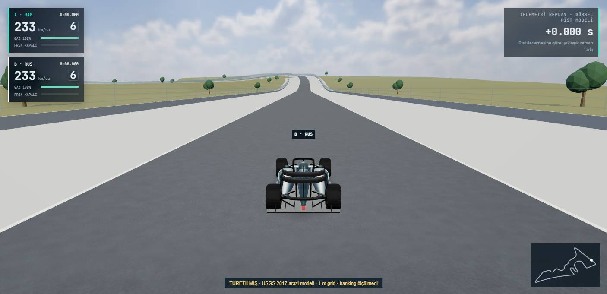
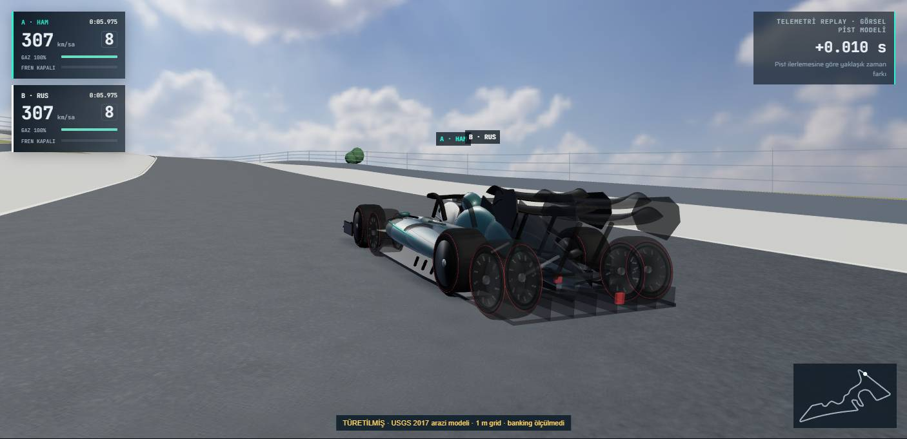
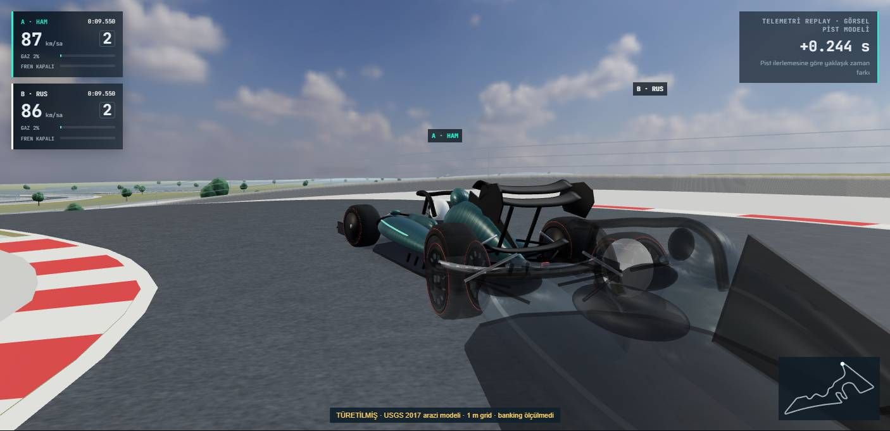
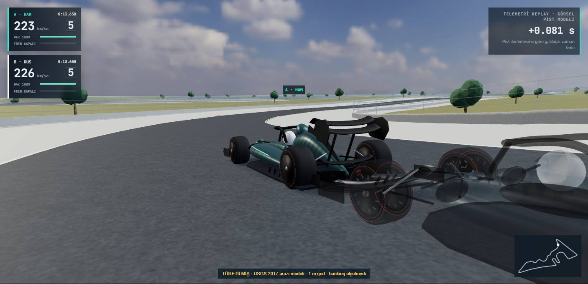
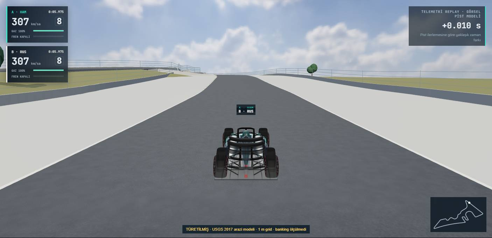
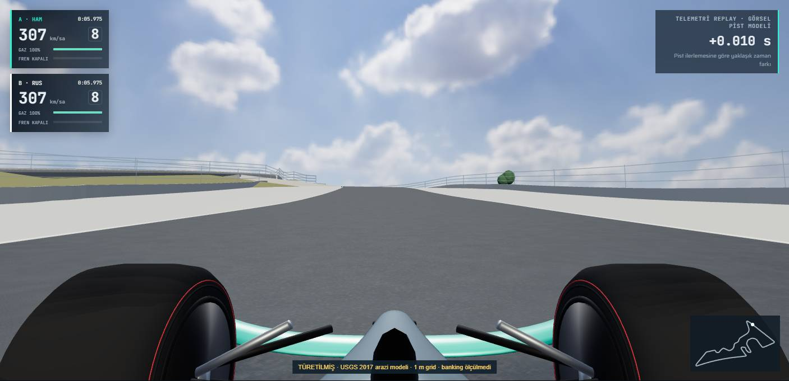
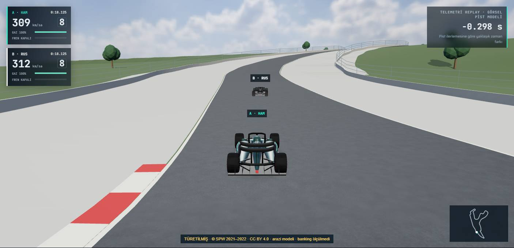
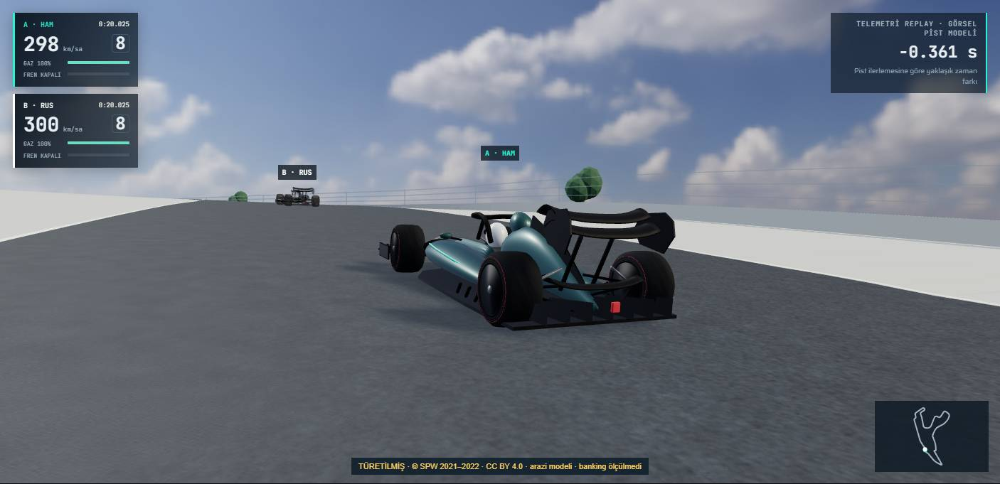
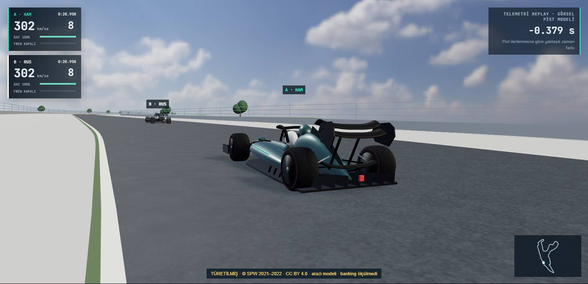
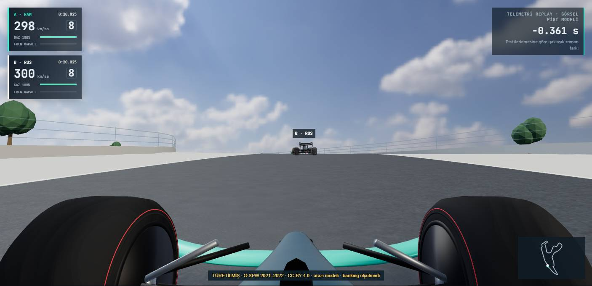

# V6: gerçek kaynaklardan türetilmiş pist topografyası

Güncel devam çalışması: [V6.1 performans optimizasyonu ve kabul durumu](V6-1-PERFORMANS-OPTIMIZASYONU.md). Aşağıdaki V6 ölçümleri tarihsel başlangıç kanıtı olarak korunur. Yeni fiziksel NVIDIA tekrarları doğrulanmadığından PR #10 taslak kalır.

Başlangıç: V5 main `a237ca529b31bd769df90165c62f73cdef54a672`. Bu çalışma `feat/v6-real-track-topography` dalında incelemeye sunulur; main'e birleştirilmez. Buradaki “gerçek kaynak” asfaltın mühendislik ölçümü anlamına gelmez. Kabul edilen iki profil, açık lisanslı **arazi modellerinden türetilmiştir**; banking ve süspansiyon ölçülmemiştir.

**Teslim durumu: [taslak PR #10](https://github.com/hamitkaantokmak-jpg/tur-duellosu/pull/10). İşlevsel doğrulama başarılı; %10 performans hedefi tüm koşullarda karşılanmadı.** Spa 1440p Ultra takip/kokpit koşullarında tekrarlar dahil pencere medyanı kayıpları %11.65 / %19.93 kaldı. Performans kabulü verilmedi; bağımsız inceleme ve V6 performans düzeltmesi gerekiyor. Main değişmedi.

## Pist durumları

| Pist | Veri kaynağı | Doğruluk sınıfı | Üretimde etkin mi? |
|---|---|---|---|
| COTA | USGS 3DEP, TX_Central_B1_2017, raster 116248, 1 m grid; yaklaşık 20 m boyuna örnek | `derived`: 2017 çıplak arazi, yaklaşık MIT merkez çizgisi; asfalt doğruluğu belirsiz | V6 PR dalında evet, coğrafi hizalama kabul edilirse; main değişmedi |
| Spa | © SPW, MNT 2021–2022, 23.01.2024 güncellemesi, 0.5 m grid; yaklaşık 40 m boyuna örnek | `derived`: çıplak arazi, yaklaşık MIT merkez çizgisi; köprü/asfalt farkı belirsiz | V6 PR dalında evet, coğrafi hizalama kabul edilirse; main değişmedi |
| Meksika | Bu çalışma için kabul edilmiş asfalt/ince eğim profili yok | `unavailable`: mevcut düz referans | Gerçek yükselti hayır; mevcut düz davranış korunur |

Hiçbiri `verified` asfalt ölçümü olarak etiketlenmez. Görsel yol genişliği 14 m ve sıfır enine eğim model varsayımlarıdır; ölçülmüş genişlik veya düz banking iddiası değildir. Kaynak rasterin 1/0.5 m grid'i, profilin 20/40 m örnek aralığı veya ekrandaki 2×1 m asfalt üçgenleriyle karıştırılmamalıdır. İnterpolasyon yeni gözlem üretmez.

## Kaynak araştırması ve kararlar

### Resmî pist belgeleri

[COTA işletmecisinin T1 açıklaması](https://circuitoftheamericas.com/blog/2024/2/16/what-your-favorite-cota-turn-says-about-you/) ve [NASCAR at COTA bilgileri](https://www.nascaratcota.com/news/cota-facts.html), tepenin varlığı için bağlam sağlar. Yaklaşık 133–134 feet ifadesinden ayrıntılı profil üretilmedi. [FIA 2024 COTA planı](https://www.fia.com/sites/default/files/decision-document/2024%20United%20States%20Grand%20Prix%20-%20Event%20Notes%20-%20Circuit%20Map%2C%20Pit%20Lane%20Drawing%20and%20Red%20Zones.pdf) pist düzenini gösterir; bu araştırmada yeniden kullanım izni verilmiş mesafe–kot/banking tablosu elde edilmedi. Belge geometrisi kopyalanmadı.

[Spa organizatörünün açıklaması](https://www.spagrandprix.com/fr/le-circuit), Eau Rouge deresinin pist altından geçtiğini belirtir. Arazi modelinin köprüleri dışlaması bu nedenle açık belirsizliktir; dere yatağı kotunun asfalt kotuna eşit olduğu varsayılmadı. Elde edilen profil, bu bölgede geniş ölçekli iniş/yükselişi göstermek için kullanılır; köprü tabliyesi veya asfalt kesitinin hassas rekonstrüksiyonu değildir.

### Kabul edilen coğrafi kaynaklar

**COTA:** [USGS 3DEP](https://www.usgs.gov/3d-elevation-program/) ürünleri serbest kullanımlı ABD kamu verisidir. [Raster metadatası](https://elevation.nationalmap.gov/arcgis/rest/services/3DEPElevation/ImageServer/116248?f=pjson) `TX_Central_B1_2017`, 1 m, NAVD88, 28.01–22.03.2017 edinimini belirtir. Kaynak QA [QL2 raporu](https://rockyweb.usgs.gov/vdelivery/Datasets/Staged/Elevation/metadata/TX_CentralTexas_2017_A17/TX_Central_B1_2017/reports/CentralTexasLiDARQAQC_FinalReportDeliverable_20180105.pdf) NVA için RMSE ≤0.10 m spesifikasyonunu verir; bu değer yerel asfalt doğruluğu olarak aktarılmaz. Query EPSG:4326, servis EPSG:3857, düşey metre/NAVD88. Sunucu koordinat dönüşümü ve bilinear örnekleme yapar. Raster ID ve 1 m çözünürlük her yanıtta doğrulanır. Servis katalog metadatası depoda saklanır.

Ek makullük kontrolü: [SRO/GT America pist belgesi](https://www.gtamerica.us/documents/notice/1357/1458891346ab3b1c866bbefd3bd1fe.pdf), start/finish için 30.1335278 / −97.6422583 koordinatında 154.8 m bildirir. Aynı noktadaki kilitli USGS sorgusu 154.861 m verdi. [Ham çapraz kontrol](performance/v6/cota-published-anchor.json). Belgenin düşey datumu açıklanmadığı için 6.1 cm fark bir yerel hata sertifikası veya datum dönüşümü olarak kullanılmaz; profil bu noktaya göre ayarlanmadı.

**Spa:** [SPW veri fişi ve lisans](https://geoportail.wallonie.be/catalogue/a004e570-99d6-4fe5-b83d-49b774409278.html): CC BY 4.0; kaynak EPSG:3812, düşey DNG EPSG:5710, metre, 0.5 m grid. Kurumun bildirdiği bölgesel mutlak düşey doğruluk yaklaşık 0.12 m'dir; merkez çizgisi ve asfalt farkını kapsamaz. Sunucu EPSG:4326 sorgularını kaynak sisteme dönüştürür. Kaynak bildirimi arayüzde ve dosyalarda bulunur; değişiklikler örnekleme, filtreleme, başlangıç kotunu çıkarma ve interpolasyondur. Lisans bağlantısı ve atıf [kaynak dizininde](../assets/topography/sources/README.md) korunur. Bankingi DEM kenarlarından çıkarmadık.

Yatay referanslar [Bacinger COTA](https://github.com/bacinger/f1-circuits/blob/master/circuits/us-2012.geojson) ve [Spa](https://github.com/bacinger/f1-circuits/blob/master/circuits/be-1925.geojson), MIT. Tam izin/telif bildirimi [CENTERLINE-LICENSE.txt](../assets/topography/sources/CENTERLINE-LICENSE.txt) içinde. Harita merkez çizgilerinin mühendislik ölçümü doğruluğu yoktur.

### Üretim profili için kabul edilmeyen diğer kaynaklar

- [Copernicus DEM](https://dataspace.copernicus.eu/explore-data/data-collections/copernicus-contributing-missions/collections-description/COP-DEM): GLO-30/GLO-90 için [açık lisans](https://documentation.dataspace.copernicus.eu/APIs/SentinelHub/Data/DEM/resources/license/License-COPDEM-30.pdf) mevcut; WGS84/EGM2008 metre. Yüzey modeli ve 30/90 m grid, asfalt bankingi veya küçük Meksika eğimlerinin doğrulaması için yeterli değil. Daha iyi yerel kaynaklar varken COTA/Spa için kullanılmadı.
- [NASA SRTM](https://www.earthdata.nasa.gov/s3fs-public/2025-05/SRTM_Quick_Guide.pdf): küresel açık yükseklik adayı; WGS84/EGM96, yaklaşık 30 m. 2000 edinimi COTA'nın inşasından öncedir; bugünkü pist asfaltı profili için uygun değildir. Spa/Meksika için de hassas asfalt/banking kaynağı kabul edilmedi. Veri içeri aktarılmadı.
- [INEGI MDE/CEM](https://www.inegi.org.mx/programas/mde/) ve [CEM metadatası](https://www.inegi.org.mx/contenidos/temas/mapas/relieve/continental/metadatos/continuo_elevaciones.pdf): Meksika için araştırılan resmî aday. Bu görevde pist boyunca lisans/metadatası ile doğrulanmış, yeterli yerel asfalt kotu ve hata bütçesi elde edilmedi; model üretime eklenmedi. Bu, INEGI'de uygun başka ürün bulunmadığı iddiası değildir.

### Telemetri Z incelemesi

[FastF1 kaynak belgesi](https://github.com/theOehrly/Fast-F1/blob/master/fastf1/core.py), XYZ için 1/10 m birimini ve bazı konumların interpolasyon olabileceğini açıklar. Yazılımın açık lisansı, altta yatan F1 verisinin yeniden dağıtım lisansı değildir. [OpenF1 Location](https://openf1.org/docs/#location) konumu yaklaşık olarak tanımlar; sıfır noktasının belirli coğrafi konuma bağlı olmadığı belirtilir. Bunlardan NAVD88, DNG veya asfalt ölçüm doğruluğu çıkarılamaz.

Mevcut [TracingInsights 2024 arşivi](https://github.com/TracingInsights/2024) gerçekten Z kanalı içerir: COTA HAM yaklaşık 1265.66–1569, Spa HAM 3654.99–4679 ham birim. FastF1 sözleşmesiyle 0.1 m varsayımı makul olsa bile arşiv dosyasında düşey datum/yerel hata/ölçüm lisansı doğrulanmadı. Bu Z, yeni gerçek yükseklik kaynağı yapılmadı. Mevcut telemetri yükleme ve isteğe bağlı temsili Z davranışı korunur; yeni DEM profili etkinse Z onun yerine geçmez. Telemetri dosyaları bu PR'da tekrar dağıtılmaz.

## Tekrarlanabilir işleme

1. `scripts/fetch-real-topography.cjs cota` resmî getSamples servisini raster 116248'e kilitler. Ham noktalar, istek parametreleri, tüm yanıtlar ve edinim zamanı saklanır. Spa için aynı Node aracı veya Windows HTTP alternatifi `scripts/fetch-spa-topography.ps1` kullanılabilir; Node bağlantısının zaman aşımı kaydı başarı sayılmaz.
2. Yatay referans, mevcut `ReplayCore.circuit` yerel equirectangular dönüşümüyle metreye çevrilir (`111320*cos(lat)` / `111320`), ilan edilmiş yatay tur uzunluğuna ölçeklenir. COTA faktörü 0.9978317, Spa 1.0026172. Bu yaklaşık harita kaydıdır; yüksek hassasiyetli jeodezik ölçüm değildir. Sorgu noktaları aynı dönüşümün tersinden bulunur; otomatik testler geri dönüşümü kontrol eder.
3. COTA 276, Spa 176 DEM sorgusu. Ham kayıtlar ayrı kalır. Bir periyodik `[1,2,1]/4` filtre geçişi uygulanır; filtrelenmiş istasyon sıfır yüksekliği çıkarılır. En büyük ham/filtre farkı COTA 0.300 m, Spa 0.840 m. Kırpma, 40 m'ye büyütme veya hayalî ara kontrol noktası yoktur. Kapanış noktası başlangıcın açık kopyasıdır.
4. `scripts/prepare-real-topography.cjs` kaynak SHA256'larını ve yüzey sınırlarını doğrular; JSON ile tarayıcı JS çıktısını üretir. `.gitattributes`, hash'leri Windows/Linux satır sonu dönüşümünden korur. Veri klasörü ve servis yanıtları uygulamada ağdan tekrar yüklenmez.
5. V5 `sampleAtDistance` ve periyodik monoton kübik C1 interpolasyon korunur. Ham noktalar `sourceIndex`, filtrelenmişler `filtered-dem`, kapanış `periodic-closure` ile ayrılır. Ara değerler interpolasyondur. Yeni gerçek profilde mutlak boyuna eğim için 0.30 kabul sınırı, banking için sıfır/ölçülmedi kontrolü vardır.
6. Harita poligonunun keskin yapay köşeleri yatayda simetrik `[-6,-3,0,3,6] m`, `[1,2,3,2,1]/9` çekirdeğiyle yumuşatılır. İstasyon ve kot örnekleri değişmez. Yatay sapma COTA'da en fazla 0.901 m, Spa'da 0.881 m'dir; <1.5 m testi vardır. Bu sapma gerçek asfalt hassasiyeti iddiası değildir. Asfalt şeridi 2 m boyuna, 1 m enine tessellation kullanır; mutlak eğim %3.5'i aşınca boyuna ek ara kesit eklenerek yaklaşık 1 m'ye iner. Asfalt tek draw call olarak kalır. Ek arazi ölçümü veya dekorasyon eklenmez.

[Sayısal veri özeti](performance/v6/data-quality.json): COTA'nın ham kot aralığı 151.107–182.098 m; filtrelenmiş göreli aralığı yaklaşık 30.662 m, en büyük boyuna eğimi %13.24. Spa ham kotları 366.578–468.841 m; filtrelenmiş göreli aralığı yaklaşık 102.051 m, en büyük eğimi %14.59. COTA profili tanıtım kaynaklarındaki yaklaşık 40 m değerine büyütülmedi. İstasyon sıfırı, merkez çizgisi dosyasının başlangıcıdır; start/finish telemetri kaydının fazından bulunur.

## Uygulama, zamanlama ve kameralar

Yeni coğrafi kayıt yalnız `ghostBuild` görselleştirmesinde yapılır. Analizin `H.L`, örnek sayısı, kaynak mesafeleri, hız/gaz/fren/vites/RPM ve saatleri değiştirilmez. A telemetrisiyle 25 m RMSE altında kayıt bulunursa aynı dönüşüm iki araca uygulanır; bu eşik kayıt korumasıdır, hata garantisi değildir. Test örneklerinde COTA ~6.77 m, Spa ~7.06 m RMSE. Uygun kayıt yoksa gerçek profil uygulanmaz. Meksika'nın mevcut kayıt ve render yolu aynen kullanılır.

Üç boyutlu ark uzunluğu hiçbir tur saatine yazılmaz. Dört gerçek GLB tekerlek temasından katı destek düzlemi kullanılır; gerçek süspansiyon/lastik fiziği yoktur. Pitch/roll/yaw, kerb ve bariyer drape, kokpit up vektörü, takip/TV/serbest kamera ve çarpışma önbelleği V5 katmanlarını kullanır. Meksika venue/LOD modülleri yalnız Meksika'da çalıştırılır; COTA/Spa'ya Meksika yapıları yüklenmez.

## Test ve performans kanıtları

Son test/performance özeti, ham kayıtlarla birlikte [performance/v6](performance/v6/) dizininde tutulur. V5 referansı yeniden çalıştırıldı: **39/39 birim, 24/24 tarayıcı**. V6: **47/47 birim, 27/27 tarayıcı**, sıfır atlama/retry. Veri ve geometri testleri; hash, koordinat dönüşümü, filtre, sınırlar, döngü, gerçek araç desteği, gerçek asfalt mesh raycast, kamera sürekliliği, telemetri fingerprint'i ve 120 saniye oynatmayı içerir. Mevcut tüm testler korunur. [Birim kaydı](performance/v6/unit.txt), [tam tarayıcı kaydı](performance/v6/browser.txt), [test edilen kaynak](performance/v6/tested-source.json).

- Meksika HAM **76.651 s**, RUS **76.356 s**, delta **−0.295 s**; iki ilerleme de 1. COTA HAM/RUS **94.154 / 92.974 s**, Spa **113.835 / 114.095 s**. Kanallar ve kaynak zaman/mesafe fingerprint'leri korunur.
- Optimizasyon sonrası COTA gerçek profilde 120 s oynatma: 0.25× hızda **30.268 s**, geometri **189→189**, doku **11→11**. Üç kalite/kamera/Stüdyo geçişinde aynı renderer ve aynı telemetri. Bariyerlerin yerel gruplara ayrılması nesne sayısını artırdı; toplam buffer büyüklüğünü artırmadı. [Uzun test](performance/v6/cota-soak.json).
- 0.125 s aralıklı tüm tur kontrollerinde katı destek düzleminin en büyük tekerlek artığı COTA **31.35 mm**, Spa **19.63 mm**. Seçili 11 Ultra karesinde gerçek asfalt mesh'ine 88 tekerlek raycast sonucu **−21.92…+11.17 mm**. Bu ±25 mm görsel kabul eşiğidir; kusursuz dört tekerlek teması veya süspansiyon doğruluğu iddiası değildir. Santimetre ölçeğindeki bu artıklar kalan teknik sınırlamadır. [Görsel/temas manifesti](performance/v6/visual/manifest.json).
- Beş sürekli kamera modunda 10 µs komşulukların düşey farkı COTA en fazla **0.104 mm**, Spa **0.163 mm**. Yayın kamerasının tasarlanmış kesmeleri süreklilik iddiasına dahil değildir. Meksika bariyer ve sentetik tepe çarpışma testleri de korunup yeniden geçti.

İlk Spa testi, kaba asfalt şeridinde yaklaşık 10 cm gömülme buldu; boyuna/enine tessellation ve yatay harita köşelerinin yumuşatılmasıyla giderildi. [Başarısız kayıt](performance/v6/first-spa-mesh-failed.txt), [ilk temas sayıları](performance/v6/first-spa-contact.json). İlk tam koşuda **26 geçti / 1 başarısız**: takip LOD'u çizilmeden alınan bellek tabanı, ilk yüklenen 19 geometriyi büyüme saydı. Ölçüm öncesi hem üstten hem takip çizimi yapıldı; bütçe artırılmadı. Yeni 120 s koşuda artış sıfırdır. [İlk tam başarısız kayıt](performance/v6/first-full-failed.txt). Son kabul koşusu bütünüyle yeniden çalıştırıldı.

İlk performans taraması 32 pencere sonunda durduruldu: COTA 1080p Performans kokpitte yaklaşık **%31.4 FPS kaybı** vardı. [İlk ham matris](performance/v6/initial-matrix.json). Ters sıralı tanılama, oynatma tick'i ile benzersiz rAF zamanlarının eşit olduğunu gösterdi; sayacın çift kare saydığına ilişkin bulgu yoktu. Araç yüzey uyarlaması yaklaşık **0.12–0.15 ms/kare**, kamera çarpışması **1.60 ms/kare** tuttu. Sıklaştırılmış bariyerin tek büyük mesh'i, kısa kamera ışınında da uzak üçgenleri taratıyordu. Bariyer quad'ları aynı konum/materyalle 128 m yerel hücrelere gruplandı; mevcut `CameraCollision` sistemi ve geçersizleştirmesi korundu. Dar faz maliyeti yaklaşık **0.09–0.10 ms/kare** oldu; toplam geometri buffer byte'ı değişmedi. Görünür draw call sayısı artabilir; bu, uzak üçgenlerin erken elenmesi karşılığında ölçülmüş bir tercihtir. [Önce tanılama](performance/v6/diagnostic-collision-before.json), [sonra ters sıralı tanılama](performance/v6/diagnostic-collision-after.json).

Meksika'nın değişmeyen çizim yolunda bile bazı sınırsız kare pencereleri 120–160 FPS ile 340–460 FPS arasında değişti. Bu değerlerden yazılım hızlanması veya sınırsız GPU kapasitesi sonucu çıkarılmaz. Kesin dış durum nedeni kanıtlanmadı. Son ölçümlerde benzersiz rAF, render sayısı, CPU/GPU süreleri ve GPU saatleri de kaydedilir; ilk başarısız/değişken koşular silinmez.

Performans ölçümü `scripts/audit-v6.cjs` ile: aynı fiziksel **NVIDIA RTX 5060 Laptop / ANGLE D3D11**, sürücü **621.14**, Chrome **157.0.8103.39**, gerçek 1920×1080 / 2560×1440 tamponlar, DPR ve render oranı 1, adaptif çözünürlük/AO kapalı, 1× oynatma; Performans ve Ultra, takip ve kokpit. Her hücre 20 s gerçek oynatma ısınması ve 12 s ölçüm kullanır. FPS ve p95 tüm ölçüm penceresinden hesaplanır. Geometri/doku byte alanları sahne tamponu ve doku depolama **tahminleridir**, ölçülmüş VRAM değildir. V5 COTA/Spa normalize düz sahne, V6 coğrafi arazi sahnesidir; aynı son kullanıcı koşullarının karşılaştırmasıdır, aynı üçgenlerin karşılaştırması değildir. Kare limiti kapatma bayrakları istenir; sunum tavanına takılmak sınırsız GPU kapasitesi göstermez.

### Son performans sonucu

Son uygulama sürümünde **48 tam matris + 30 tekrar = 78 ölçüm penceresi** kaydedildi. [Ham matris](performance/v6/final-matrix.json), [24 ilk karşılaştırmanın tamamı](performance/v6/PERFORMANS.md), [ham tekrarlar](performance/v6/rechecks.json). Ek olarak ilk 32 pencere ve 9 tanılama penceresi geçmiş kanıt olarak korunur; bunlar son kabul sürümüne karıştırılmaz.

İlk matris %10'u beş koşulda aştı. Bu beş koşul, veri silinmeden, önceden kaydedilmiş `V6,V5,V5,V6,V6,V5` sırasıyla üçer kez tekrarlandı. Her sürümde ilk pencere + üç tekrarın **pencere FPS ortalamalarının medyanı** alındı. Diğer 19 koşul ilk penceresini korur. Bu bir güven aralığı değildir; iyi görünen tek pencere seçilmedi. [Önceden belirlenen plan](performance/v6/recheck-plan.json), [tekrarların tamamı ve aralıklar](performance/v6/TEKRARLAR.md), [makine özeti](performance/v6/repeat-summary.json).

| Tekrarlanan koşul | V5 medyan FPS | V6 medyan FPS | Kayıp | p95 pencere medyanı V5→V6 |
|---|---:|---:|---:|---:|
| Meksika 1080p Performans takip | 468.6 | 503.4 | −%7.43 | 2.85→2.65 ms |
| Meksika 1440p Ultra kokpit | 397.4 | 416.4 | −%4.78 | 3.30→3.20 ms |
| Spa 1440p Performans kokpit | 690.4 | 663.9 | %3.83 | 1.85→1.95 ms |
| **Spa 1440p Ultra takip** | **668.5** | **590.7** | **%11.65 — hedef aşımı** | **1.90→3.85 ms** |
| **Spa 1440p Ultra kokpit** | **681.2** | **545.4** | **%19.93 — hedef aşımı** | **2.00→2.65 ms** |

COTA'nın sekiz ilk karşılaştırmasında en büyük kayıp %3.75; Spa 1080p'de %0.49, Spa 1440p Performans takipte %6.79 oldu. İlk ham matrisin en büyük tek pencere farkı %75.02 idi; bu değer silinmedi veya son medyanla değiştirilmedi. Son ham gate de, tekrar medyanı gate'i de `false` olarak saklanır.

GPU'nun P4/P0 durumu ve çekirdek/bellek saatleri pencereler arasında değişti. Yaklaşık 500 FPS hem V5 hem V6'nın aynı Meksika koşulunda gözlendi; büyük pozitif farklar yazılım hızlanması olarak sunulmaz. Son tekrarların tamamında tick ve benzersiz rAF sayıları kaydedilir. Saat/power geçişinin kesin dış nedeni kanıtlanmadı; laboratuvar düzeyinde sabit saat garantisi yoktur.

Kalan maliyette daha yoğun yol/zemin ve artan çizim grupları dikkate alınmalı. Örneğin Spa 1440p Ultra kokpit sabit t=10 anında draw call **111→148**, üçgen **209260→440328**, sahne geometri buffer'ı **6854768→26382120 byte**, doku depolama tahmini **36503632→36503632 byte**. Bu bir bellek sızıntısı değildir; daha yoğun statik yüzey ve bariyer gruplamasının maliyetidir. Saat değişkenliği nedeniyle bütün FPS farkını tek bileşene kesin olarak bağlamıyorum. Çarpışma için yerel hızlandırmayı çizim gruplamasından ayırmak ve uzak yol geometrisinin yükünü azaltmak V6'da açık performans işi olarak kalır; bu PR bu konuda kabul edilmiş sayılmaz.

Yeniden üretim: V5 `a237ca5` arşivini ve PR dalını ayrı statik portlarda çalıştırın; `CHROMIUM_PATH` tanımlayıp `node scripts/audit-v6.cjs` kullanın. Sonuç `final-matrix.json` olur. Tam test: `npm run test:unit`, `node node_modules/@playwright/test/cli.js test`. Kanıt toplama için Playwright çıktısı `work/v6-post-opt-results` ise `node scripts/collect-v6-evidence.cjs`; istatistikler için `node scripts/summarize-v6.cjs` ve `node scripts/summarize-v6-repeats.cjs`. Tekrar planı ve tüm pencere sırası ham dosyalardadır. Performans başarısızken PR taslak kalır; main'e birleştirilmez.

Görseller gerçek Ultra uygulama ekranlarıdır; her karede `TÜRETİLMİŞ`, veri kurumu ve banking'in ölçülmediği bilgisi görünür. [Görsel dizini](performance/v6/visual/) COTA start/finish, T1 yaklaşım/tepe/iniş, takip/kokpit ve Spa Eau Rouge/Raidillon/tepe/kokpit karelerini içerir.

| COTA start/finish | T1 yaklaşımı |
|---|---|
|  |  |
| T1 tepesi | T1 sonrası iniş |
|  |  |
| Takip | Kokpit |
|  |  |
| Spa Eau Rouge | Raidillon |
|  |  |
| Raidillon tepesi | Spa kokpit |
|  |  |

## Sınırlar ve yeni pist ekleme

2017 ve 2021–2022 arazi yüzeyleri güncel asfalt mühendislik kotları değildir; yeniden asfaltlama ve dönem farkı belirsizdir. Köprü, tünel, kerb yüksekliği, kesin genişlik ve banking doğrulanmadı. Bir X/Z'de birden fazla yol seviyesi desteklenmez. Çevre zemini 16 m yaklaşık grid'dir; gerçek çevre arazisi veya mimari rekonstrüksiyonu değildir. Telefon, başka GPU, 4K ve AO kombinasyonları ayrı doğrulama ister.

Yeni pistte önce açık lisans ve kaynak/datum/birim/çözünürlük/hata bilgisi doğrulanır; merkez çizgisi ve DEM ham yanıtları hash'lenir. Yeterli kapsama yoksa etkinleştirilmez. Veri hazırlama aracına açık kaynak tanımı eklenir; `RealTopography` olay eşlemesi ancak veri testleri, gerçek mesh teması, kamera ve zamanlama regresyonundan sonra açılır. Banking için bağımsız ölçüm gerekir; boyuna DEM'den çıkarılmaz. V7 kapsamı veya yeni dekorasyon eklenmedi.
