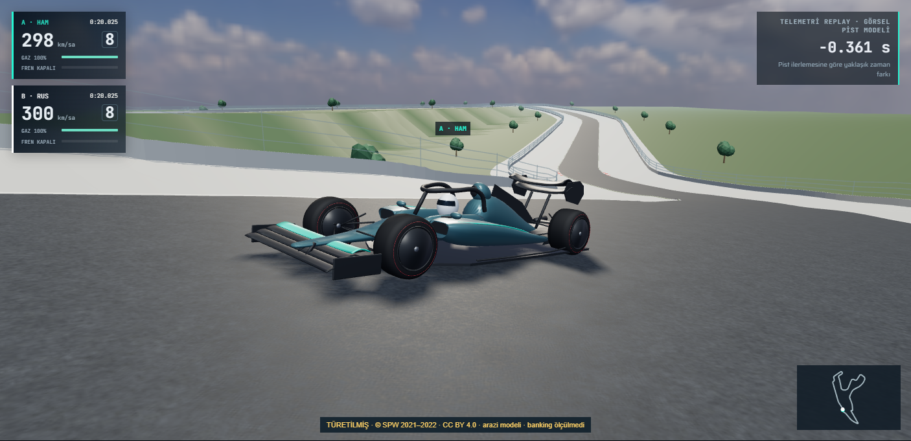
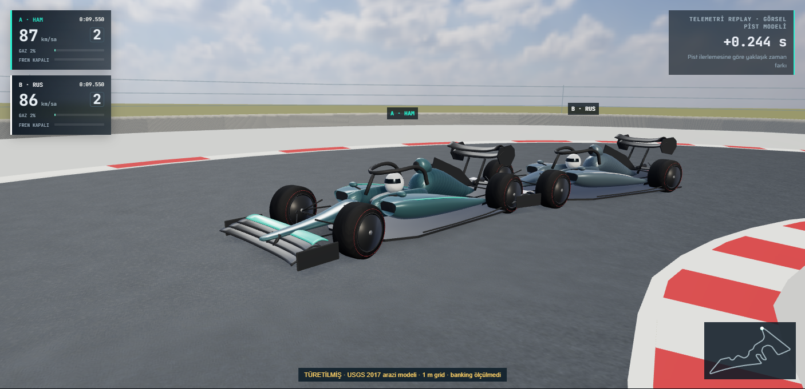
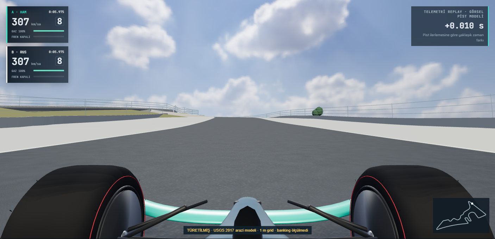

# V9 — Fiziksel GPU performansı ve genel kalite denetimi

Başlangıç main: `ad35d61f5b26ed1d5ff6d82a3ee43b91478cee94`. Dal / mevcut PR: `audit/v9-performance-quality` / #14. Önceki [yazılımsal denetim](V9-PERFORMANS-KALITE-DENETIMI.md) ve bütün ham kayıtları korunur; V7.1 uygulama/model değişiklikleri alınmadı. **738 fiziksel GPU penceresi tamamlandı. Sayısal %10 FPS eşiği geçti; tekrar kararlılığı geçmedi. NVIDIA performans borcu ve kokpit halo/yakın düzlem kalite bulgusu açık; PR #14 taslak.** Main'e merge veya canlı dağıtım yapılmaz.

## Değişiklik ve denetim kapsamı

Yeni pist, araç modeli, dekorasyon, fizik veya kalite profili eklenmedi. Tek uygulama değişikliği, `ghostScenery` açıklama metni aynıysa yeniden DOM yazısı yapılmamasıdır. Metin, kamera, topografya, ışık, materyal, gölge, geometri ve LOD eşikleri korunur. Test edilen yerel uygulama `e0bc34698170e4a2035b505ad4bec501d5c330e7`; fetch edilebilir yayımlanan benchmark adayı `12b85328235b095d2362a44e058cc28ec023d302` olarak donduruldu. Önceki V9 kanıtları korunduğu için bütün Git ağaçları farklıdır; uygulama/varlık ve tarayıcı test dosyalarının tamamı byte düzeyinde eşittir: [doğrulanmış eşleme](performance/v9-nvidia/source-publication.json). V8 arşivi ayrıca tutulur.

V5–V8 yüzey interpolasyonu, destek pozu, tekerlek/direksiyon pivotları, görsel hareket tablosu, kamera çarpışma önbellekleri, render/raycast bariyer gruplaması, ortak GLB/doku sahipliği ve Veri Stüdyosu geçişleri kaynak ve test düzeyinde incelendi. Değişmeyen bileşenler sırf yeniden yazmak için değiştirilmedi. Kaynak verisi veya araç sanatı dosyası güncellenmedi.

## Ölçüm koşulları ve tanılama

[Önceden belirlenmiş protokol](performance/v9-nvidia/PLAN.md), [makine planı](performance/v9-nvidia/plan.json), [ham profil ölçümleri](performance/v9-nvidia/profile.json), [A/B/A/B DOM deneyi](performance/v9-nvidia/dom-diagnostic.json). Pilot/profil/deneyler kabul FPS'ine katılmaz; ilk başarısız başlangıç ve sayaç denemeleri de aynı dizinde tutulur.

Fiziksel NVIDIA GeForce RTX 5060 Laptop GPU, sürücü 621.14 ve Intel i7-13700HX / 24 mantıksal CPU gözlendi. WebGL debug renderer ANGLE/NVIDIA/D3D11; SwiftShader kabul edilmez. AC bağlı, pil tasarrufu kapalı, sistemin mevcut Dengeli güç planı korunur. Yalnız test Chrome süreçlerinde Windows HighQoS/timer kısıtlaması kapatılarak OS'nin bildirdiği yüksek performans çekirdeklerine (16 mantıksal çekirdek) affinity uygulanır. GPU saat kilidi mevcut kullanıcı yetkisiyle uygulanamadı; saatler/power limit sabitlenmiş gibi sunulmaz. Her ölçümde süreç/güç durumu ve saniyelik GPU telemetrisi saklanır.

Kontrolsüz aynı V5 sahnesinde yaklaşık 159/678 FPS gözlenmesi, tek pencerenin kabul için yetersiz olduğunu gösterdi. Süreç kontrolü sonrasında beş sürümlü pilot tamamlandı; bu geçmiş kayıtlar seçilerek silinmedi. İlk sayaç denemesinde replay dışında bir ek render yakalandı; sayaç yalnız benzersiz replay RAF'ında tamamlanan render'ları FPS sayacak, diğer render'ları ayrıca kaydedecek şekilde düzeltildi.

Profilde Spa V8'in lastik oturtması yaklaşık 0.026–0.028 ms/kare, bunun asfalt yükseklik sorgusu yaklaşık 0.022–0.023 ms/kareydi; bunlar iç içe ölçümlerdir, toplanmaz. Görsel hareket tablosu yaklaşık 0.0012–0.0015 ms/kareydi. CPU örneklerinde DOM yerleşim okumaları da görüldü. Bunun üzerine aynı açıklama metnini tekrar yazmayı önleyen A/B/A/B deneyi yapıldı: özgün pencereler 662.7/674.6 FPS, korumalı pencereler 799.0/884.8 FPS; aynı draw call/üçgen, aynı sahne/kalite/çözünürlük. Bu dört pencere bir kabul sonucu veya evrensel kazanç iddiası değildir; küçük uygulama düzeltmesinin ölçüm dayanağıdır. Asfalt indeksi veya gölge kalitesi bu tanıya dayanarak değiştirilmedi.

## Karşılaştırmalı kabul

Ana matrisin 432 penceresi ve önceden tanımlanan 17 koşulun 306 ek penceresi tamamlandı; kabul setinde 738 pencere ve sıfır geçersiz kayıt var. İlk başarısız girişim ayrıca korunur. Altı sürüm × 24 koşul × 3 pencere = 432 ana pencere. V5, V6, V6.1, V7 ve V8 istenen SHA'larından; V9 ayrıca dondurulmuş adaydan çalışır. Eşik **en fazla %10 FPS kaybı** olarak korunur. Tarihsel Spa 1440p Ultra takip/kokpit koşullarında eski raporun 20 s warmup / 12 s ölçüm aralığı ayrıca korunur.

FPS pencere ortalamalarının medyanı, p95 kare süresi, tekrar aralıkları/CV, draw call, üçgen, CPU ve GPU kullanımı, GPU saatleri/watt/sıcaklık, global VRAM, JS heap ve Three.js kaynak sayaçları ayrı raporlanır. CPU buffer/doku byte tahminleri VRAM ölçümü değildir; NVML VRAM de yalnız tek uygulamaya ait değildir. Yaklaşık 60 Hz tavanındaki test sayaçları sınırsız GPU kapasitesi veya NVIDIA kabulü sayılmaz.

## Gerçek görsel kontrol

[Önce/sonra 26 gerçek ekran görüntüsü](visual/v9-nvidia/README.md), [kamera/poz/temas metadata'sı](visual/v9-nvidia/captures.json), [tam PNG piksel karşılaştırması](visual/v9-nvidia/pixel-comparison.json).

13 eşlenen sahne: Spa Eau Rouge/Raidillon/tepe/kokpit; COTA Turn 1 yaklaşım/tepe/iniş/kokpit; Meksika fren/viraj ve üç araç LOD seviyesi. LOD karşılaştırmalarında üç seviye açıkça zorlanır; normal otomatik LOD seçimi ayrıca mevcut tarayıcı testiyle korunur. Her sahnede iki aracın gerçek çizilen asfaltına bağımsız raycast ile destek noktası teması ölçülür; ±25 mm görsel sınır aşımı kabul edilmez.

Önce/sonra zaman, kök poz, kamera, güneş, exposure, hareket açıları, yol vertex hash'i, kalite, tampon, draw call ve üçgen eşleşir. PNG'ler byte olarak aynı değildir: toplam değişen piksel oranı en fazla %0.02141, kanal RMSE en fazla 0.1593/255'tir; farklar üst HUD yazılarındadır. Açıkça ayrıca ölçülen y≥250 dünya/araç bölgesinde 13 çiftin tamamı piksel olarak aynıdır. Tam görüntü metrikleri saklanır; orijinal görüntüler kırpılmadı veya düzenlenmedi. Bu sonuç bütün olası veriler için görsel garanti değildir.

Görsel pitch/roll, direksiyon ve tekerlek düzeltmesi V8'in belgelenmiş sınırlı yaklaşımlarıdır; gerçek süspansiyon/yük transferi/lastik deformasyonu değildir. COTA/Spa etiketli türetilmiş arazi modelleridir; ölçülmüş asfalt veya doğrulanmış banking iddiası eklenmedi. Kokpit mevcut araçüstü bakışı korur; fiziksel sürücü göz konumu veya yeni kamera modeli geliştirilmedi.

## Regresyon ve kaynak bütünlüğü

**74/74 birim ve 34/34 tarayıcı testi başarılı; atlama/retry yok.** Önceki V9 denetimi alınmadan önce ilk 60 birim testi geçti; korunmuş V9'un on ölçüm testi eklenince 70 test yeniden geçti; ardından gerçek ortak RAF sayacı için dört ek testle 74 test geçti. İlk tarayıcı koşusunda 34 test olumlu çıktıktan sonra otomatik sunucu kapanışı bu Windows çalışma ortamında tamamlanmadı; [günlük](performance/v9-nvidia/regression-teardown-interruption.log) korunur ve bu koşu nihai kabul sayılmaz. Haricî, doğrudan yönetilen Node sunucusuyla tam yeniden koşu 15.5 dakikada başarıyla kapandı ve `.last-run` passed olarak doğrulandı. Gelecek tekrarlar için `scripts/nvidia-v9/regress-v9.cjs` aynı yaşam döngüsünü shell-owned sunucu yerine doğrudan süreç handle'larıyla yönetir; `--list` yalnız listeleme/kapanış smoke'udur, test başarısı diye sayılmaz.

[Nihai test kabulü ve canonical hash'ler](performance/v9-nvidia/regression-acceptance.json), [birim kaydı](performance/v9-nvidia/unit.txt), [tam tarayıcı kaydı](performance/v9-nvidia/browser.txt) ve 120 s kayıtları aynı dizindedir. Kamera/yüzey, hız/duraklatma/geri sarma, Stüdyo geçişleri ve kaynak/heap testleri geçti. Meksika HAM 76.651 s / RUS 76.356 s / fark −0.295 s korundu. Veri, mesh ve topografya provenance kayıtları değişmedi. Eklenen eski V9 dosyaları yalnız denetim betiği/kanıt/ölçüm birim testidir; tarayıcı test gövdeleri ve uygulama/varlık dosyaları test edilen adayla aynıdır.

## Yeniden üretim

Node bağımlılıkları kurulduktan sonra Windows örneği:

```powershell
$env:CHROMIUM_PATH='C:\Program Files\Google\Chrome\Application\chrome.exe'
$env:TEST_GPU='hardware'
node scripts/nvidia-v9/regress-v9.cjs
node scripts/nvidia-v9/collect-v9-tests.cjs
node scripts/nvidia-v9/capture-v9.cjs
node scripts/nvidia-v9/compare-v9-visuals.cjs
node scripts/nvidia-v9/audit-v9.cjs --plan
node scripts/nvidia-v9/audit-v9.cjs
node scripts/nvidia-v9/summarize-v9.cjs
node scripts/nvidia-v9/summarize-v9.cjs --plan-rechecks
```

Önce rapordaki altı commit'i `git archive` ile `work/v9-versions/v5`, `v6`, `v61`, `v7`, `v8`, `v9` dizinlerine açın. Bunlar benchmark'ın kullandığı değişmez statik kaynaklardır. Protokolün seçtiği tekrar filtresi varsa `V9_FILTER` ile `node scripts/nvidia-v9/audit-v9.cjs --recheck` çalışır; ilk pencereler korunur. Profiller `node scripts/nvidia-v9/audit-v9.cjs --profile`, kabul dışı DOM deneyi `--dom-diagnostic` ile tekrarlanabilir. `.cpuprofile.json.gz` dosyaları standart gzip ile açılınca Chrome CPU profilleridir.

**Açık durum:** Sayısal FPS kapısı geçti; kararlılık kapısı geçmedi. PR taslak kalır. Main merge yapılmadı. Fiziksel NVIDIA borcu tamamen kapanmış sayılmaz.

## Nihai kabul kararı — 14 Kasım 2026

| Kriter | Sonuç | Kanıt |
|---|---|---|
| Fiziksel NVIDIA / SwiftShader dışlama | Geçti | RTX 5060 Laptop / 621.14, CDP+ANGLE+6120 NVML örneği |
| Altı sürüm × 24 koşul, tüm önceden seçilen tekrarlar | Geçti | 432 ana + 306 ek; sıfır hatalı kabul penceresi |
| V9 / V5 en fazla %10 medyan FPS kaybı | Sayısal kapı geçti | En kötü COTA 1080p Performans kokpit: %2.295652 kayıp |
| V9 / V8 en fazla %10 medyan FPS kaybı | Sayısal kapı geçti | 24 koşulda medyan FPS artışı; en küçük artış Meksika 1440p Ultra kokpit %1.736433 |
| Tekrar kararlılığı, CV≤%15 | **Geçmedi** | 28/144 sürüm-koşul çifti; V9 adayında 5/24 koşul |
| Birim / tarayıcı regresyon | Geçti | 74/74 + 34/34, skip/retry 0 |
| En az 120 s, hız/duraklat/geri sarma ve Stüdyo geçişleri | Geçti | Tam tarayıcı logu ve soak JSON dosyaları |
| Meksika telemetri ve provenance | Geçti | HAM 76.651, RUS 76.356, −0.295 s; korunan 10 canonical dosya hash’i |
| Eşlenmiş gerçek görüntüler | Temas/poz karşılaştırması geçti; genel kalite onayı değil | 13 çift; poz/kamera/mesh/temas eşleşmesi, dünya bölgesi aynı |
| Kokpit near-plane/halo görünümü | **Açık / başarısız görsel bulgu** | Önceki main bulgusu korunur; PR #13 modeli alınmadı |
| **Nihai NVIDIA performans kabulü** | **Açık / kabul edilmedi** | Dinamik çalışma değişkenliği giderilemedi; taslak PR |

[24 koşulluk önce/sonra tablosu](performance/v9-nvidia/KARSILASTIRMA.md), [144 satırlık tam metrik CSV](performance/v9-nvidia/metrics.csv), [sayısal/kararlılık incelemesi](performance/v9-nvidia/acceptance-review.json), [ayrıntılı özet](performance/v9-nvidia/summary.json). FPS aralıkları, GPU/CPU kullanımı, saat/watt/sıcaklık, geometri/doku byte tahmini ve bellek davranışı CSV/JSON’da ayrı alanlardır. Matrisin Performans/Ultra uç profilleri ölçüldü; Dengeli için ayrı performans kabulü verilmedi.

V9 adayında geçmeyen kararlılık koşulları:

| Koşul | CV % (yuvarlama kabulü değiştirmez) |
|---|---:|
| spa/2560/ultra/a | 16.203278 |
| spa/2560/performance/cockpit | 15.014956 |
| cota/2560/performance/a | 21.582059 |
| cota/1920/ultra/a | 20.725635 |
| cota/1920/ultra/cockpit | 23.968433 |

CV %15.014956 değeri %15.00 olarak yuvarlanıp başarılı sayılmadı. Bu saçılımın tek nedeninin GPU boost, CPU güç yönetimi veya uygulama olduğu kanıtlanmadı. AC/plan/çekirdek ve süreç QoS kontrolleri uygulanmış olsa da GPU saat kilidi yoktur ve makine bütünüyle sabit frekanslı değildir. Ölçülmüş bir kaynak darboğazına dayanmayan ikinci bir optimizasyon yapılmadı; kalite veya eşikler düşürülmedi. Borcu kapatmak için aynı kaynakları daha kararlı, saat/güç davranışı kontrol edilebilen bir oturumda yeniden ölçmek gerekir.

### Tarihsel Spa 1440p Ultra

| Kamera | V6/V5 kayıp % | V6.1/V5 kayıp % | V8/V5 kayıp % | V9/V5 kayıp % |
|---|---:|---:|---:|---:|
| Takip | 22.16 | 7.41 | 12.63 | -2.57 |
| Kokpit | 1.48 | 3.18 | -13.48 | -34.12 |

Negatif kayıp artıştır. V6.1’in iki medyanı %10 içindedir; takipte V6 kaybı görülürken V6.1 daha düşük kayıp gösterir. Ancak eski %11.65/%19.93 büyüklükleri birebir tekrarlanmadı; özellikle V6 kokpit %19.93 kaybı bu donanımda yeniden üretilmedi. Kararlılık sorunu nedeniyle “tarihsel borç kesin kapandı” denmez. V8 takipte %12.63 kayıp da gizlenmedi; V9 nokta tahmini iyileşse de nihai kabul verilmedi.

### Ham kayıtlar ve sayaç kapsamı

[432 ana pencere](performance/v9-nvidia/matrix.json.gz), [306 ek pencere](performance/v9-nvidia/rechecks.json.gz), [ilk durdurulan 164 kayıt](performance/v9-nvidia/main-attempt-01.json.gz), [SHA-256/boyut manifesti](performance/v9-nvidia/raw-manifest.json), [kurtarma planı](performance/v9-nvidia/counter-recovery-plan.json). Gzip açıldığında orijinal JSON byte hash’i doğrulanır; ilk girişim ve hata günlüğü silinmedi. Kabul setinde 12 yinelenen RAF callback’i tek kare sayıldı; 322 replay dışı render ayrıca kaydedildi ve FPS’e eklenmedi. Maliyetleri gerçek gözlem süresinde kaldı. CPU istatistikleri callback başınadır; FPS/p95 benzersiz damga grubunun son render bitişine göredir. Her karelik zaman serisi arşivlenmedi; ham kayıtlar pencere dağılım istatistikleri, süreç snapshot’ları ve saniyelik NVML örnekleridir.

Ölçüm sınırı kaldırılmış headless Chromium RAF/render gönderim hızıdır; fiziksel ekran sunumu, scanout FPS’i veya bütün karelerin GPU’da tamamlanması iddiası değildir. Tamamlanmış disjoint timer sorgu örnekleri ayrıca kaydedilir. En yüksek gözlenen sıcaklık 75.47°C; kabul setinde ısıl/donanımsal slowdown bayrağı yoktur. Güç limiti bayrakları görülür ve korunur. NVML global VRAM altı yerleşik sayfa ve masaüstünü içerir.

### Görsel örnekler







Tüm önce/sonra kareler [galeridedir](visual/v9-nvidia/README.md). İki turun hayalet araçları üst üste gelebilir; araçlar arası çarpışma fiziği yoktur. Zamansal süreklilik tek kareden çıkarılmadı, tarayıcı hareket/yüzey/kamera testleriyle ayrıca kontrol edildi.

### Yeniden üretim notları

Temiz checkout’ta `npm ci`, sonra `node scripts/nvidia-v9/prepare-v9.cjs` değişmez altı arşivi hazırlar; mevcut dolu arşivleri ezmez. `git archive` için core.autocrlf=false ve binary dosya çıkışı kullanılır. `node scripts/nvidia-v9/summarize-v9.cjs` paketlenmiş gzip kayıtlarını da okuyabilir. Yeni ölçümleri korunan kayıtlardan ayrı `V9_OUT` yoluna yazın. Örnek tekrar filtresi `recheck-plan.json` içindedir; `V9_FILTER` bu filter değeriyle ayarlanıp `audit-v9.cjs --recheck` çalıştırılır. Export: `node scripts/nvidia-v9/export-tables-v9.cjs`; doğrulanmış paket: `node scripts/nvidia-v9/pack-v9.cjs`. Arşiv hazırlama betiğinin tam yeni arşiv üretimi bu son aşamada yeniden çalıştırılmadı; kullanılan altı arşiv her ölçüm oturumunda canonical Git hash’leriyle doğrulandı.

## Açık kokpit kalite bulgusu

Önceki yazılımsal V9 denetimi Meksika/COTA/Spa kokpitte halo/yakın düzlem kesişmesi buldu. Bu uygulama yalnız DOM yazısını değiştirdiği için sorun çözülmüş sayılamaz; genel görsel kalite kabulü verilmedi. PR #13’teki halosuz model değişiklikleri kapsam dışında ve alınmadı. Aynı tarihsel örnek zamanlarında fiziksel NVIDIA ile ek tekrarın metadata/görüntüleri `visual/v9-nvidia/near-plane` altındadır. İlk iki ek betik girişiminin gezinme/init hataları ayrı geçersiz klasörlerde ve günlüklerde korunur; ana 738 performans kaydı veya 34 tarayıcı testinin parçası değildir.

Ek fiziksel kokpit tekrarı tamamlandı: V8 ve V9 Meksika/COTA/Spa **66/14/11 → 66/14/11**. Beklenen tur süreleri üç pistte doğrulandı, kamera/projeksiyon/tampon/inspection aynı. [Altı gerçek PNG ve sonuçlar](visual/v9-nvidia/near-plane/README.md). Meksika’da büyük halo kirişi görüşü kapatıyor; bu başarısız genel kalite bulgusudur. Eski SwiftShader fixture hatalarının kesin kök nedeni de bu fiziksel 34/34 koşusuyla çözülmüş sayılmaz; eski ham kayıtlar korunur.
