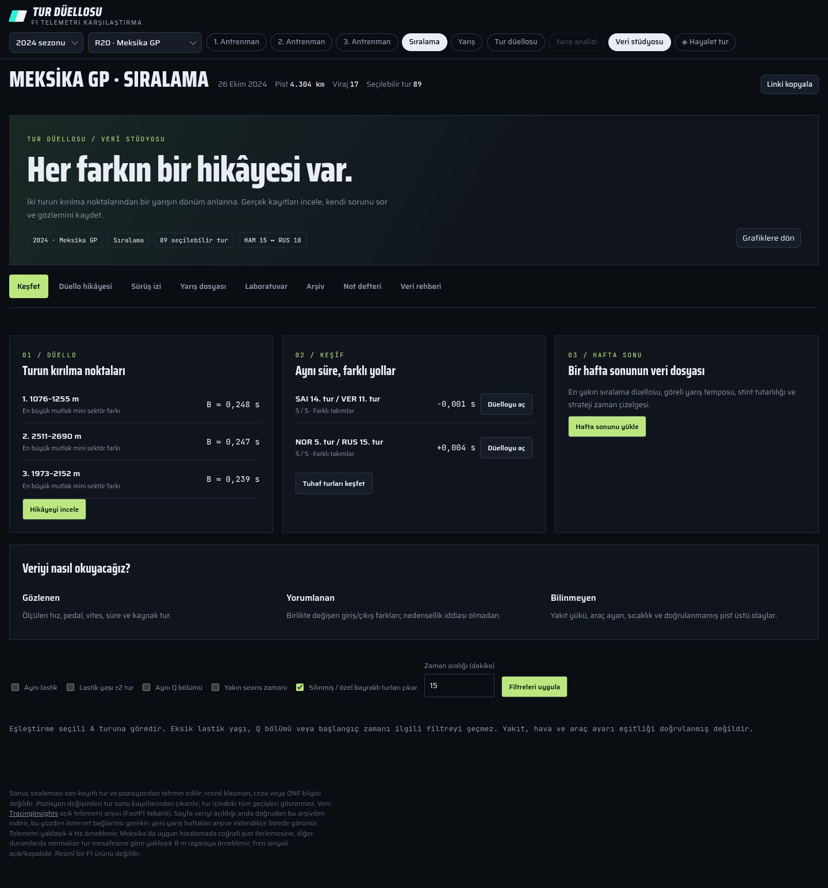
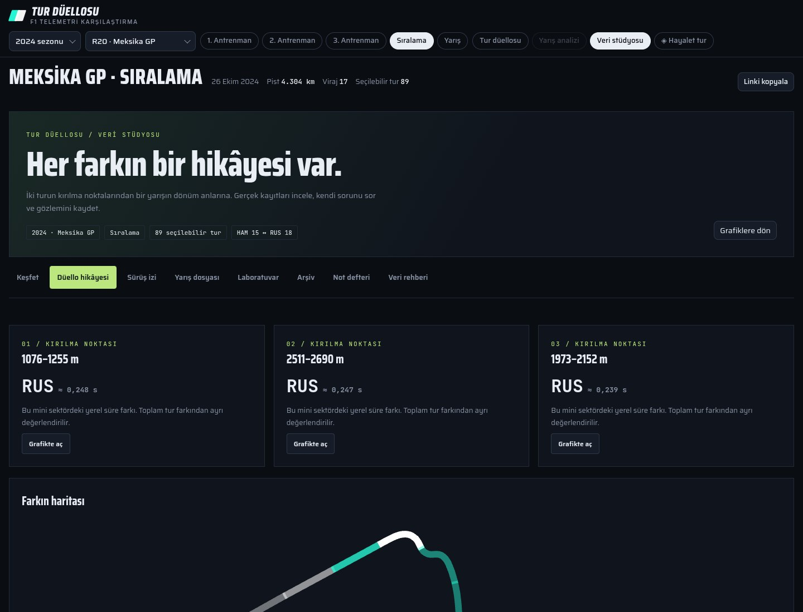
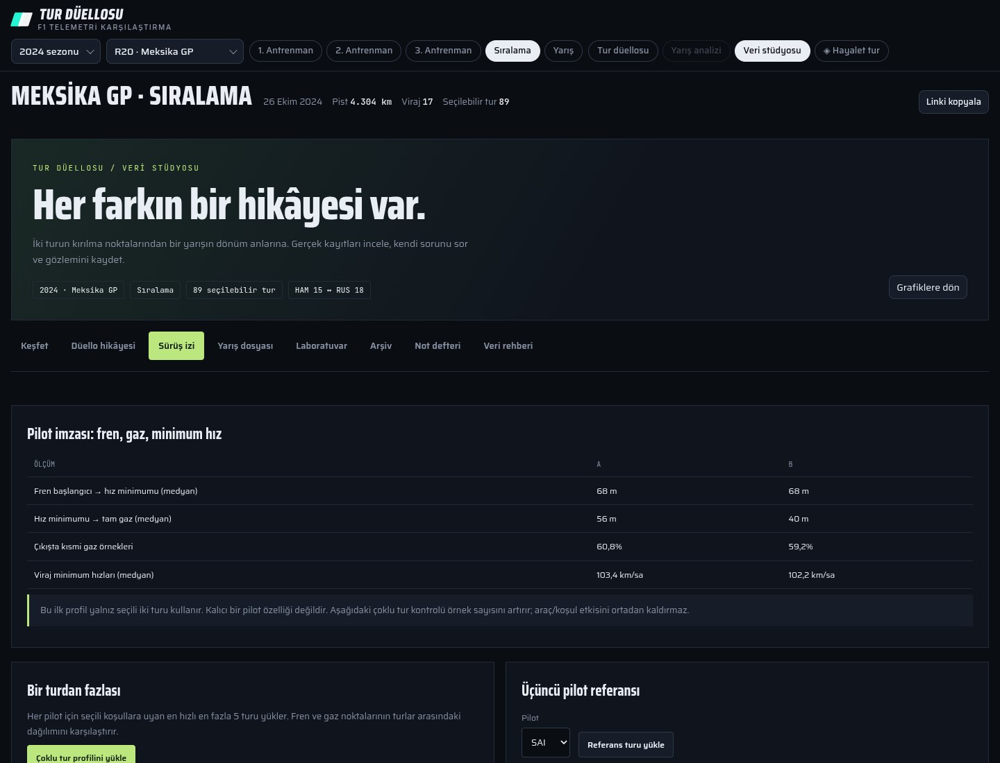
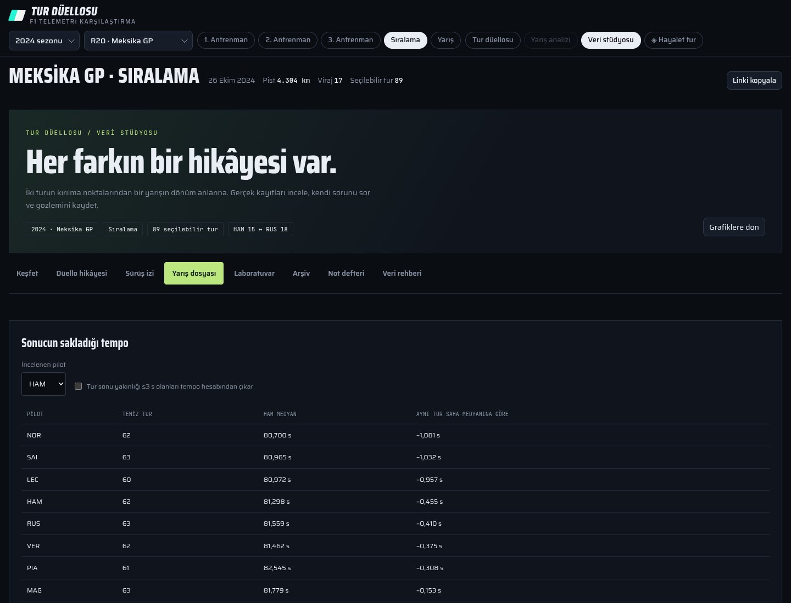
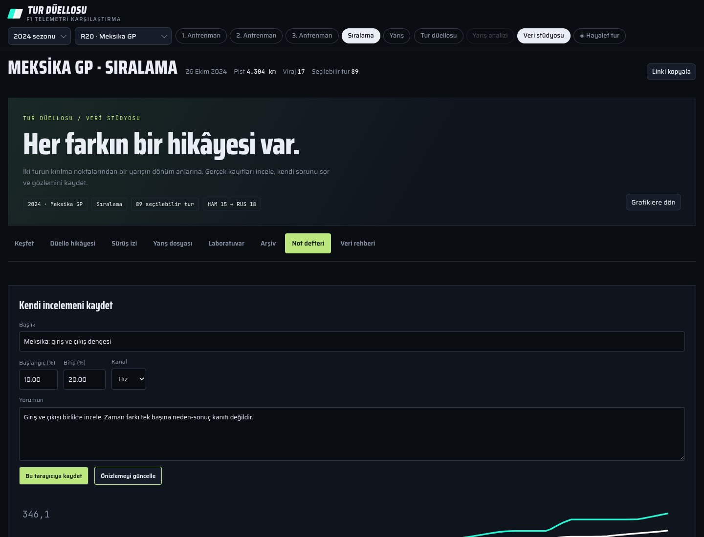
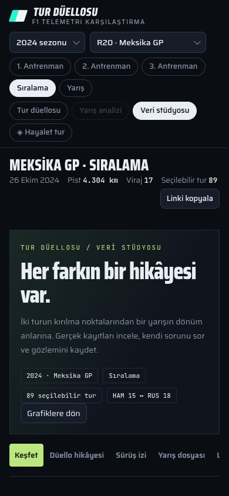

# Veri stüdyosu — gerçek tarayıcı görüntüleri

[Yöntemler ve kapsam](../VERI-STUDYOSU.md) · [Çekim kaydı](screenshots/captures.json)

1440×1100 masaüstü (genel bakış tam sayfa), 390×844 mobil; DPR1. Gerçek 2024 Meksika HAM/RUS kayıtları. Yarış dosyası aynı haftanın Race kayıtlarını ayrıca yükler; seçili sıralama düellosunu korur. Hiçbir çekimde 3D çizici başlatılmadı. Altı görüntü tek tek gözle incelendi.

## Keşfet

[](screenshots/01-overview.jpg)

## Düello hikâyesi

[](screenshots/02-duel-story.jpg)

## Sürüş izi

[](screenshots/03-driving-profile.jpg)

## Yarış dosyası

[](screenshots/04-race-dossier.jpg)

## Not defteri

[](screenshots/05-study-notes.jpg)

## Mobil görünüm

[](screenshots/06-mobile.jpg)

Yeniden üretim:

```sh
node scripts/capture-content.cjs http://127.0.0.1:4173 test-results/content-captures
```
