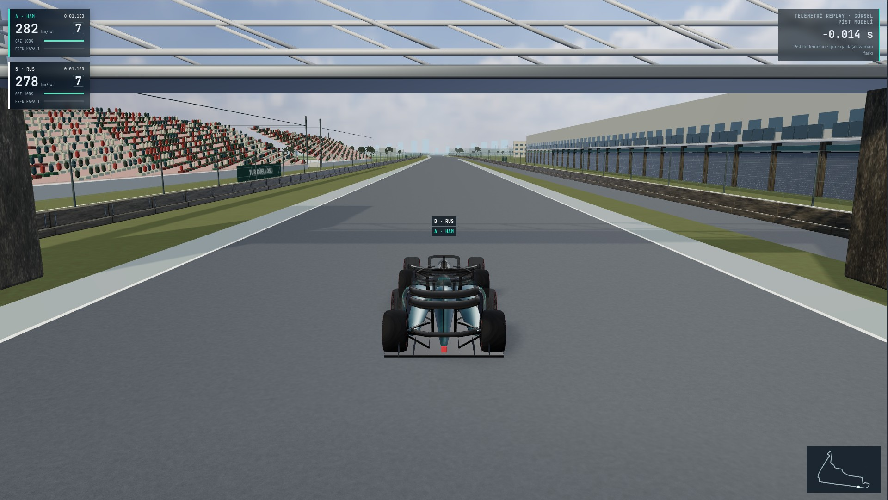
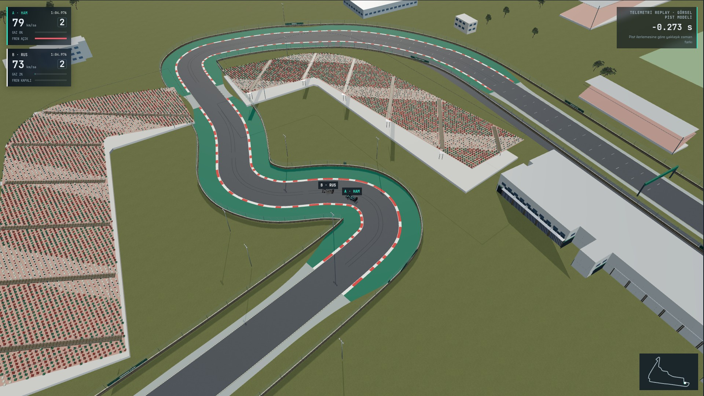
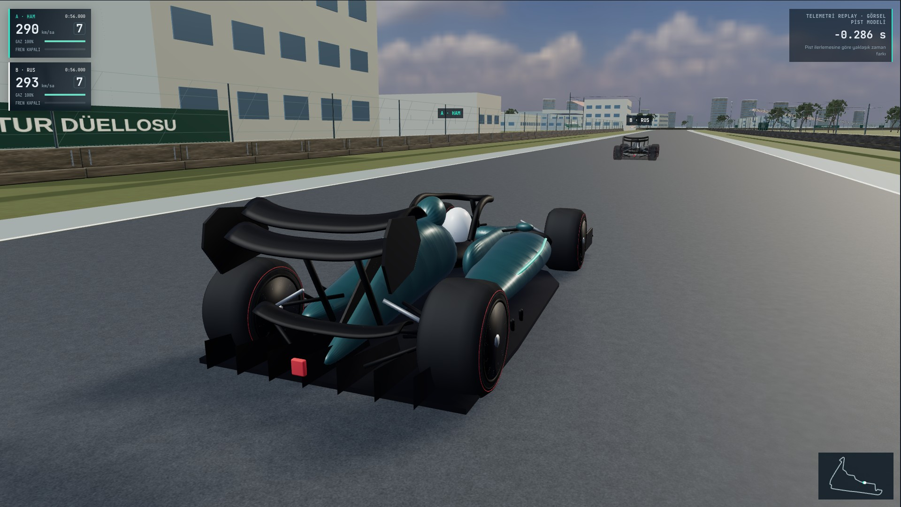
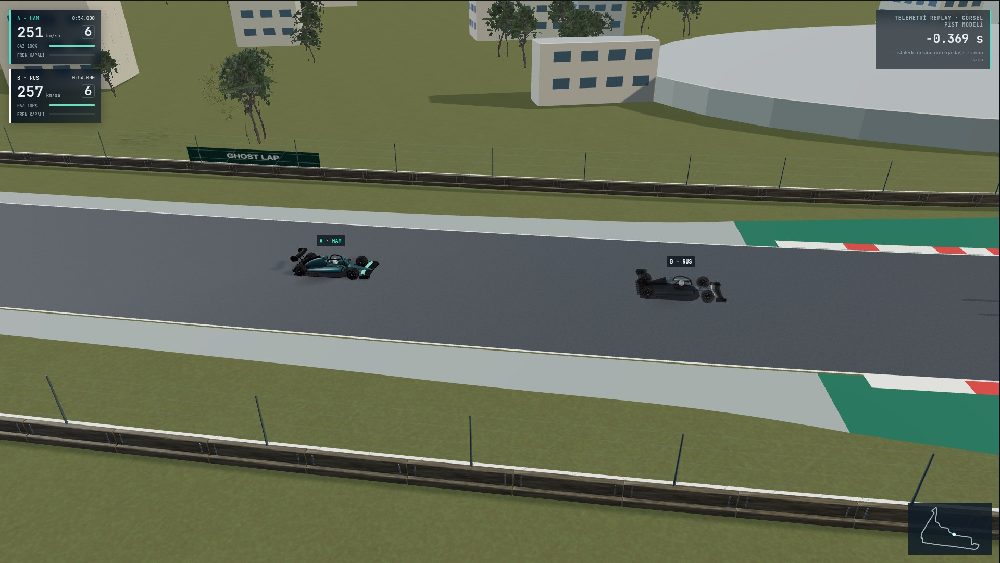

# Main adayı — gerçek Chromium son kontrolü

[Dönem sonu entegrasyon raporu](../../MAIN-ENTEGRASYON.md) · [Gerçek kamera/zaman/varlık metadatası](captures.json)

Dört kare gerçek HTTP uygulamasından 1920×1080 render ile alındı ve tek tek gözle incelendi. Ultra, DPR1, AO/adaptif çözünürlük kapalı; görüntüler performans ölçümü değildir.

## Start / finish ve pit yolu



## T12 yaklaşımı ve T13–16 stadyum



## Araç yakın çekimi



## İki araç karşılaştırması



Yeniden üretim:

```sh
node scripts/capture-v4.cjs url=http://127.0.0.1:4173 out=test-results/integration-views only=01-start-finish,05-stadium,06-car-closeup,07-ghost-comparison
```
