# V2 / V3 — gerçek tarayıcı görüntüleri

Her hücre tam 1920×1080 dosyaya açılır. Ultra, AO kapalı, DPR 1, dinamik çözünürlük kapalı; aynı HAM/RUS telemetri zamanları. İnceleme ve sınırlar: [V3 raporu](../../GELISTIRME-V3.md).

| Bölge | V2 | V3 |
|---|---|---|
| 01-start-finish | [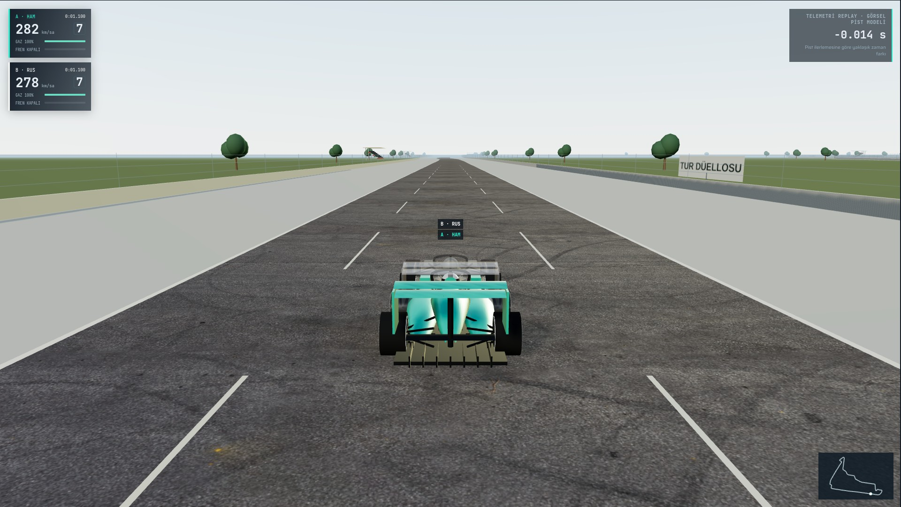](before/01-start-finish.jpg) | [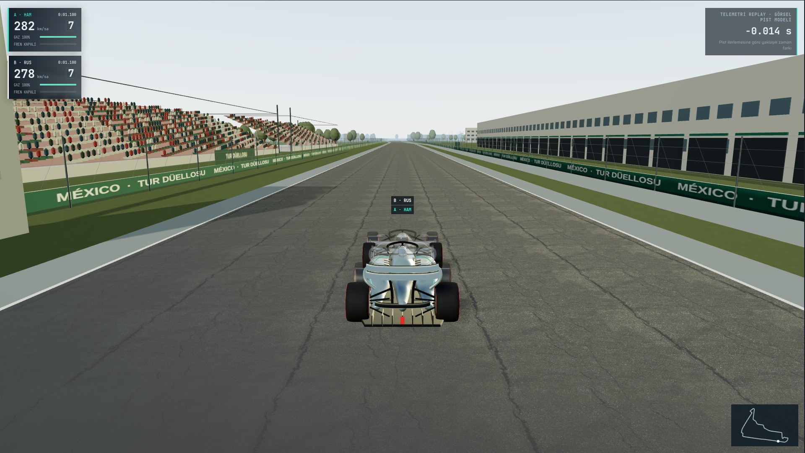](after/01-start-finish.jpg) |
| 02-turns-1-3 | [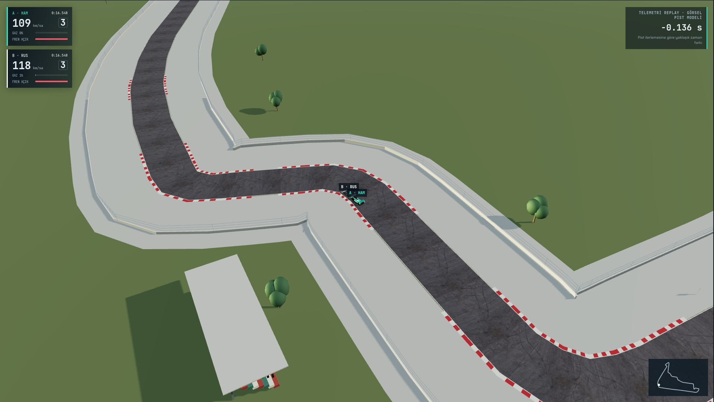](before/02-turns-1-3.jpg) | [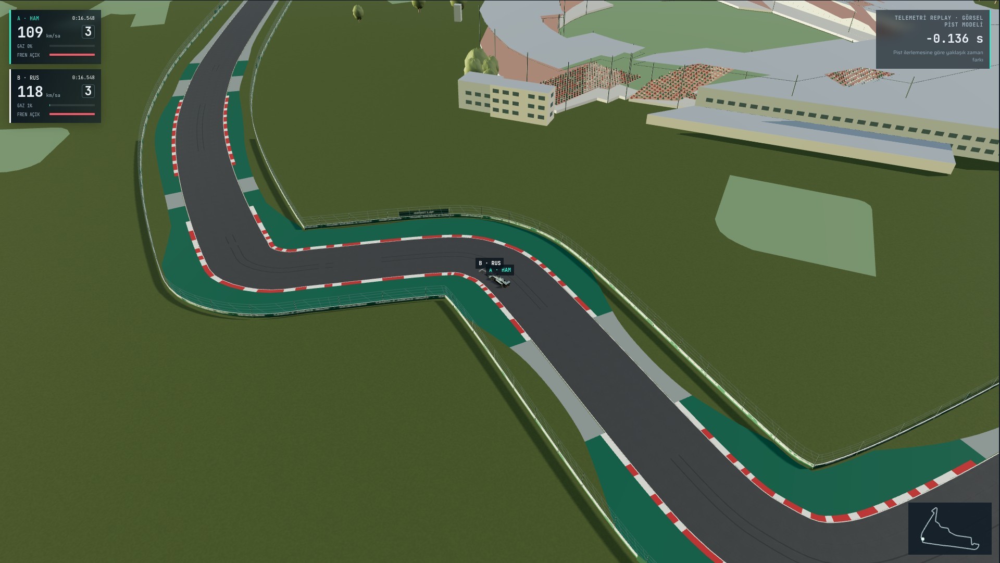](after/02-turns-1-3.jpg) |
| 03-turns-4-6 | [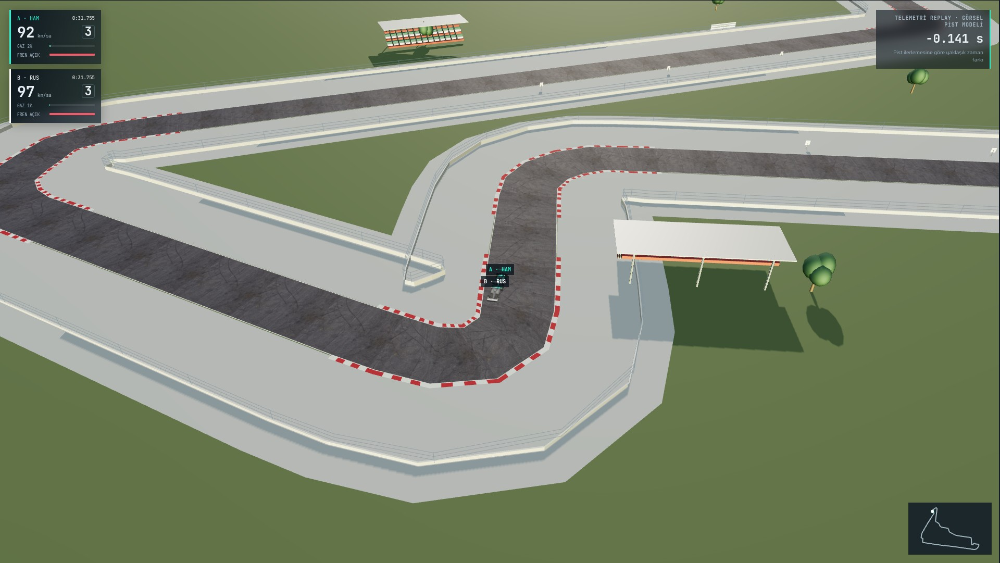](before/03-turns-4-6.jpg) | [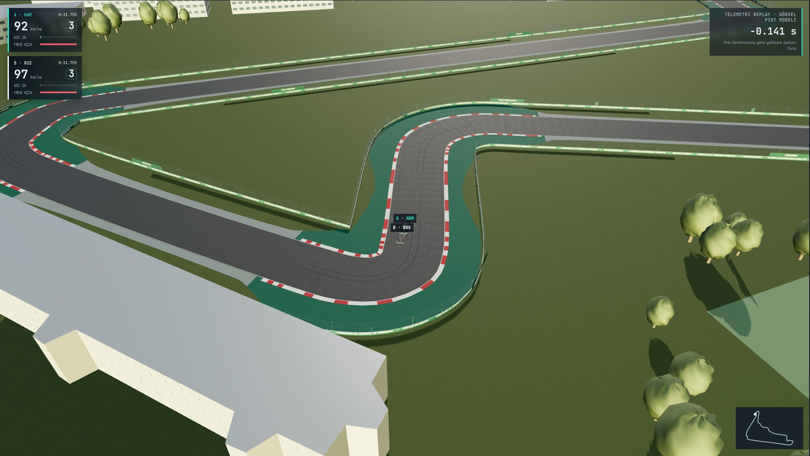](after/03-turns-4-6.jpg) |
| 04-turns-7-11 | [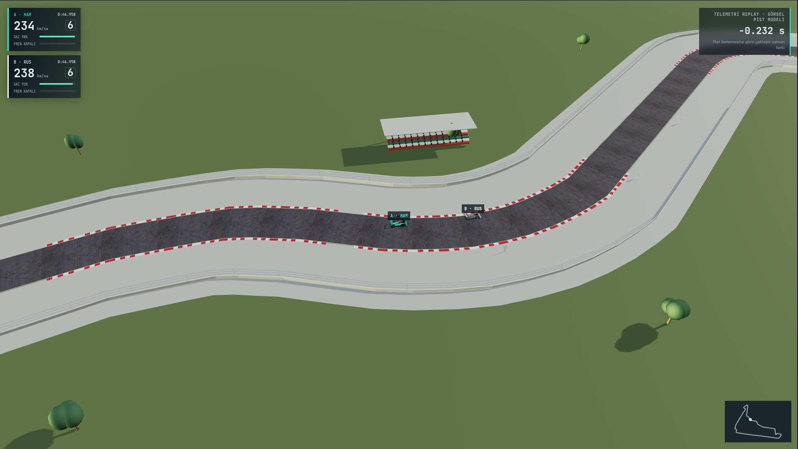](before/04-turns-7-11.jpg) | [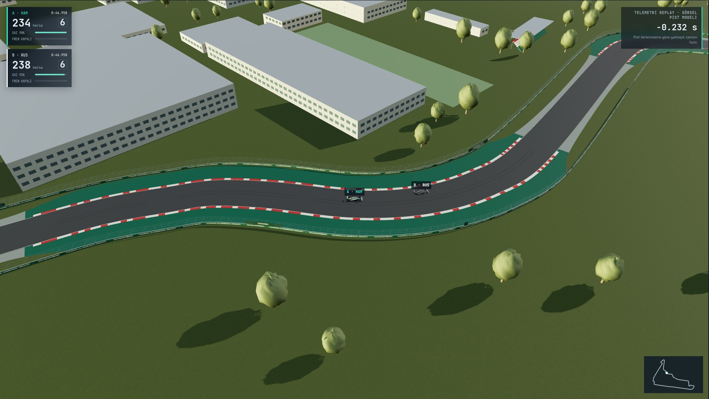](after/04-turns-7-11.jpg) |
| 05-stadium | [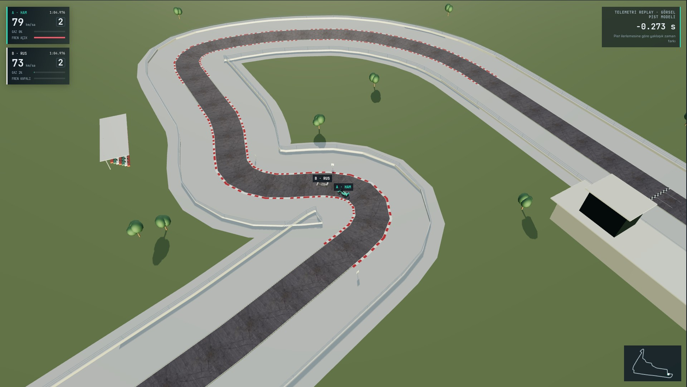](before/05-stadium.jpg) | [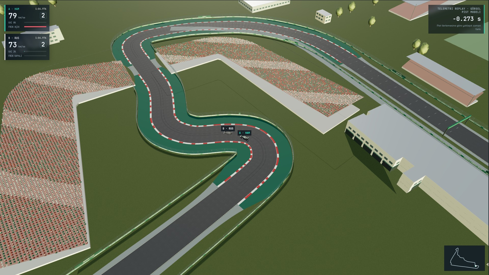](after/05-stadium.jpg) |
| 06-car-closeup | [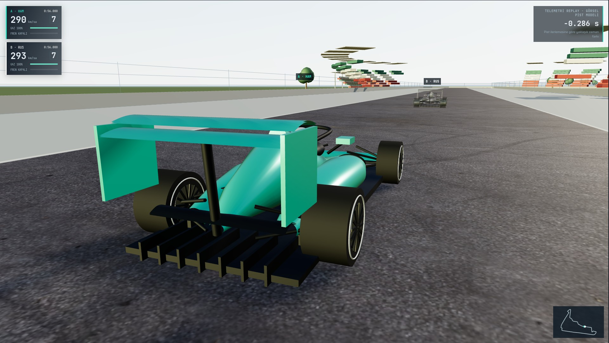](before/06-car-closeup.jpg) | [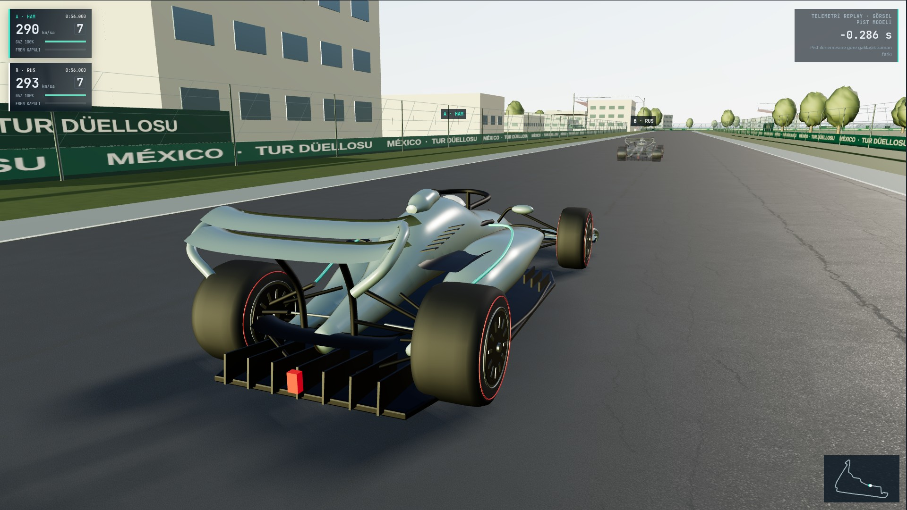](after/06-car-closeup.jpg) |
| 07-ghost-comparison | [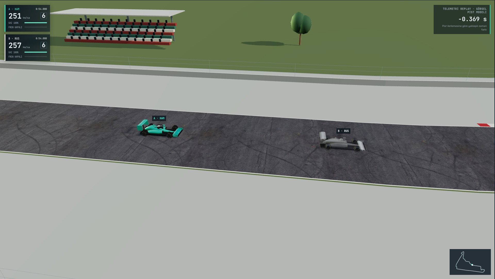](before/07-ghost-comparison.jpg) | [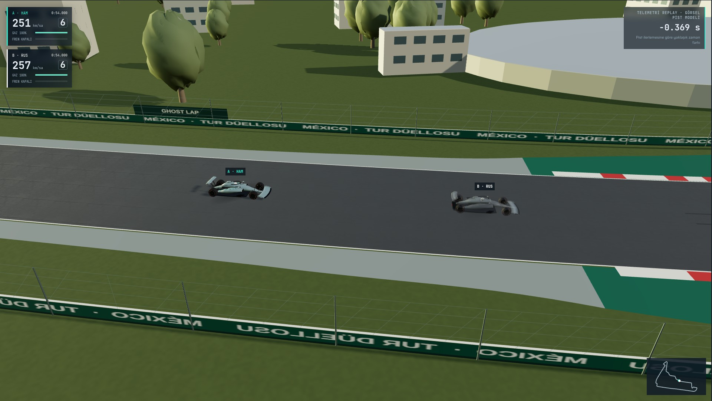](after/07-ghost-comparison.jpg) |
| 08-overview | [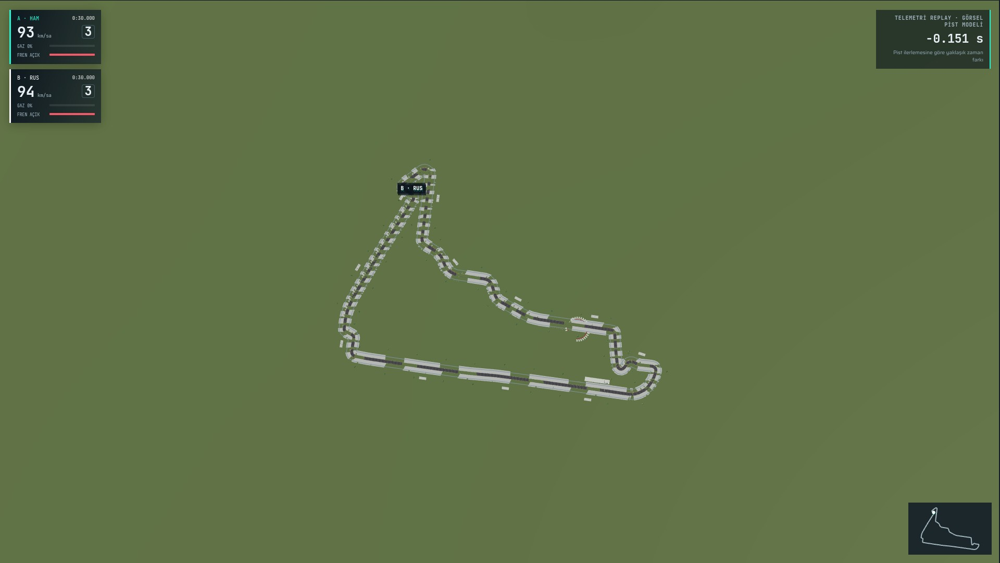](before/08-overview.jpg) | [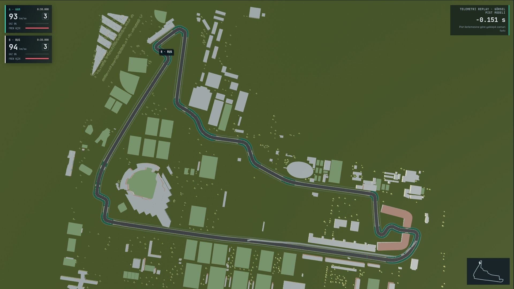](after/08-overview.jpg) |
