# V3 / V4 — gerçek tarayıcı karşılaştırmaları

[İnceleme, sınırlar ve performans raporu](../../GELISTIRME-V4.md). Her görüntü 1920×1080 gerçek render. Aynı gerçek kamera, hedef, telemetri zamanı ve kalite ayarları; DPR1, Ultra, AO/dinamik çözünürlük kapalı. Görüntüler FPS kanıtı değildir.

| Bölge | V3 | V4 |
|---|---|---|
| 01-start-finish | [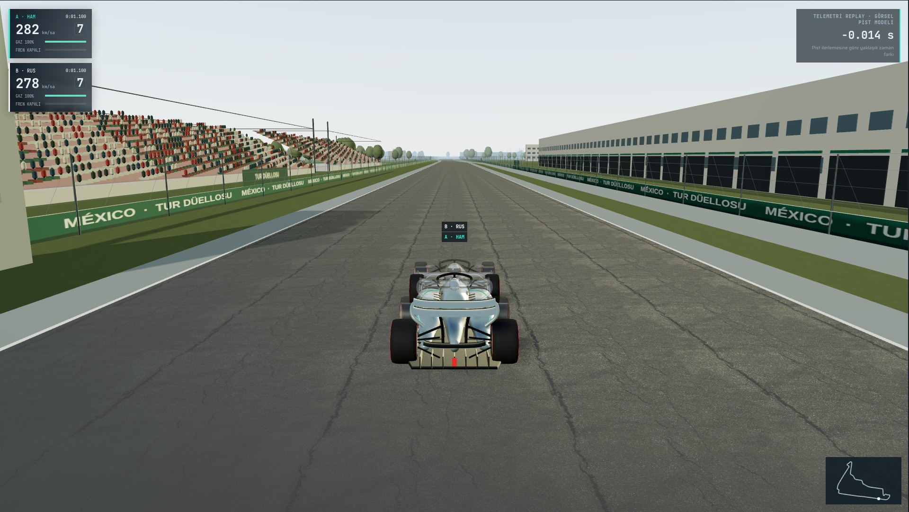](before/01-start-finish.jpg) | [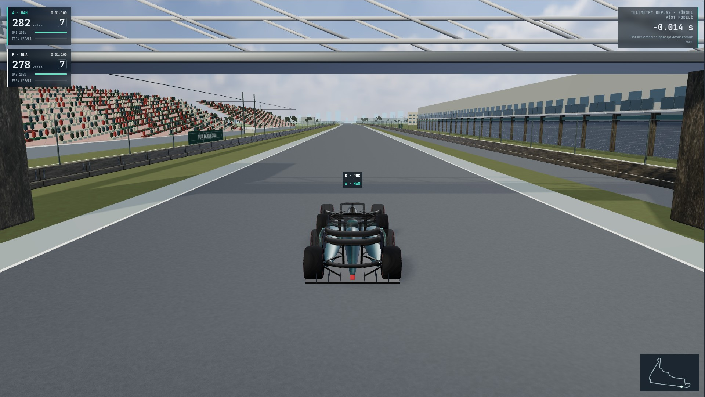](after/01-start-finish.jpg) |
| 02-turns-1-3 | [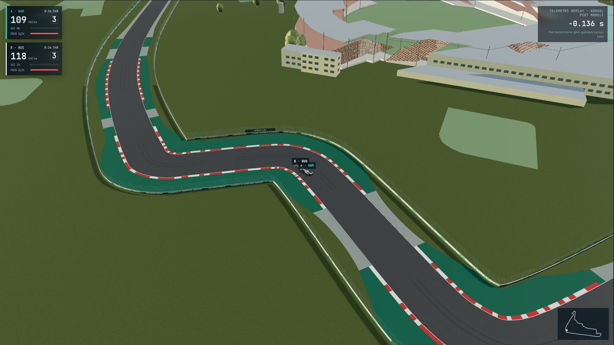](before/02-turns-1-3.jpg) | [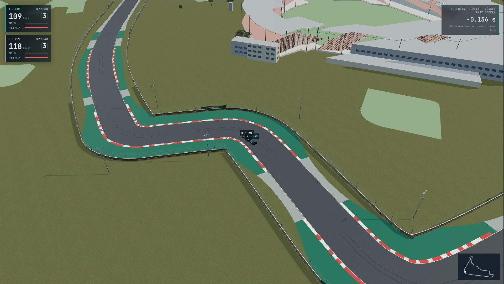](after/02-turns-1-3.jpg) |
| 03-turns-4-6 | [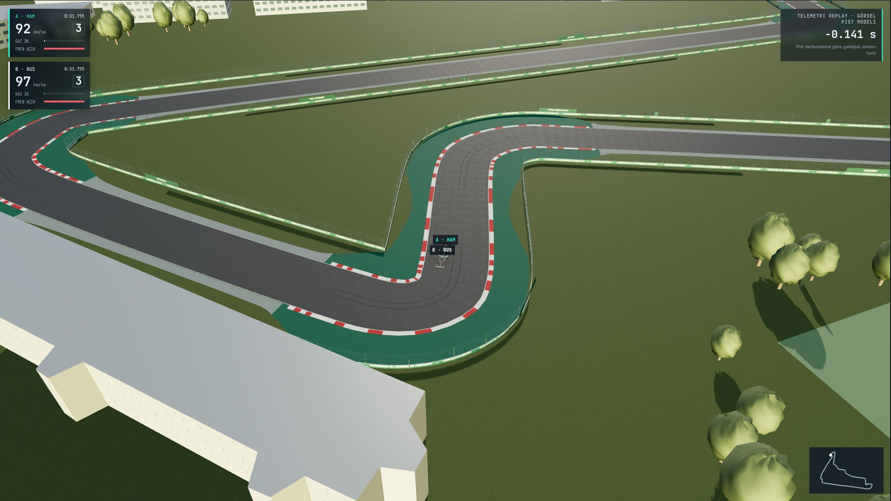](before/03-turns-4-6.jpg) | [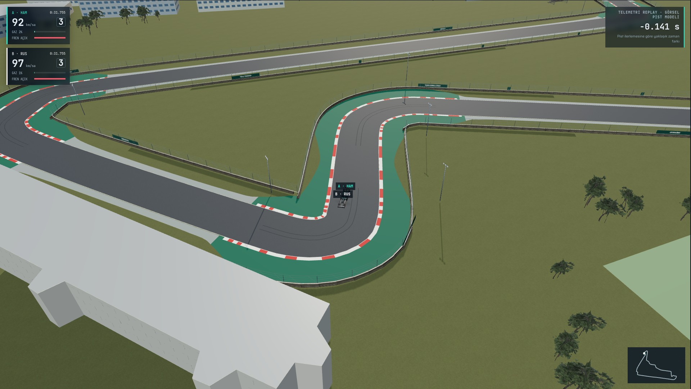](after/03-turns-4-6.jpg) |
| 04-turns-7-11 | [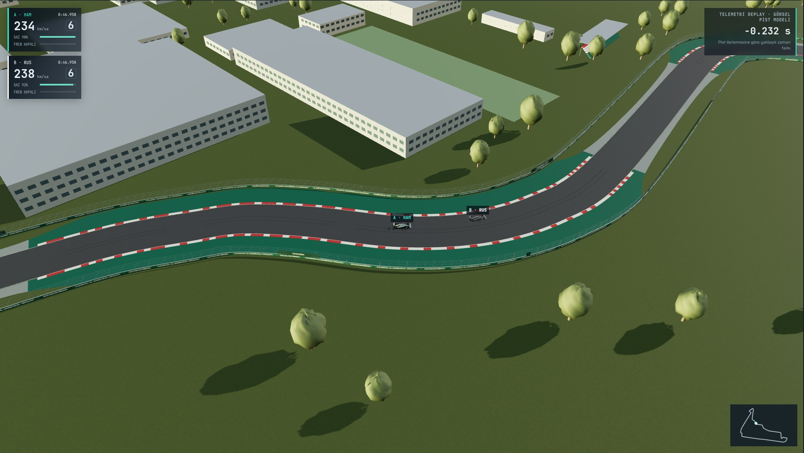](before/04-turns-7-11.jpg) | [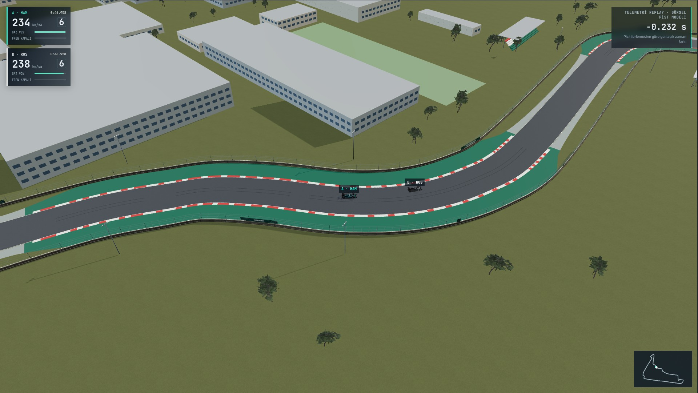](after/04-turns-7-11.jpg) |
| 05-stadium | [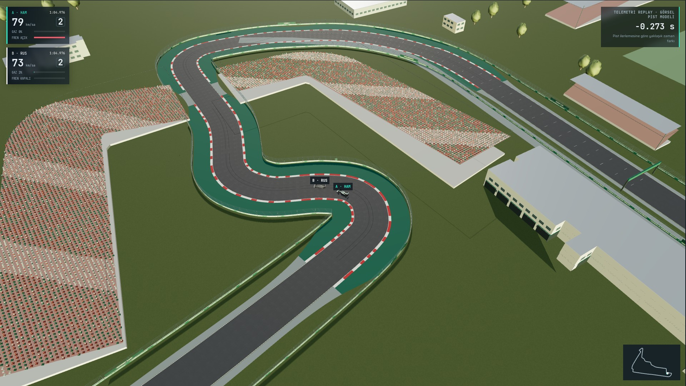](before/05-stadium.jpg) | [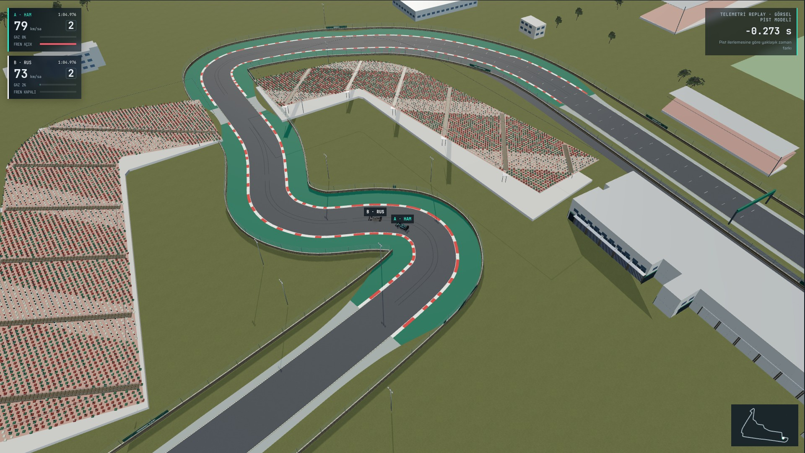](after/05-stadium.jpg) |
| 06-car-closeup | [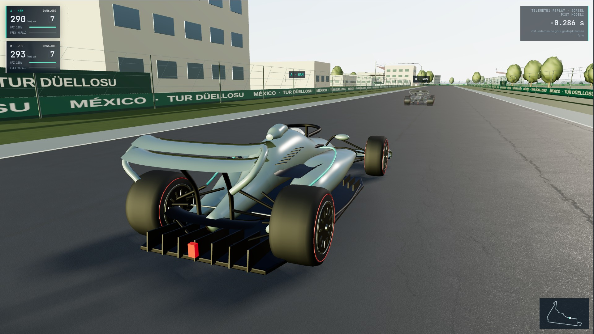](before/06-car-closeup.jpg) | [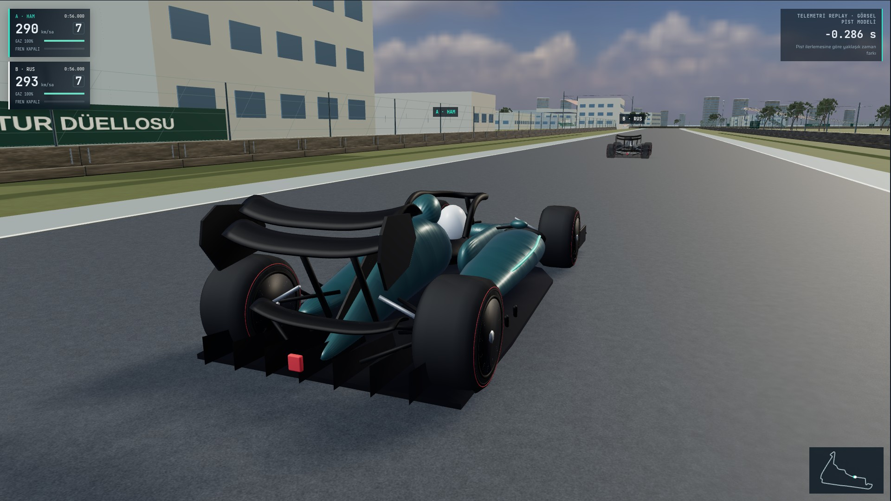](after/06-car-closeup.jpg) |
| 07-ghost-comparison | [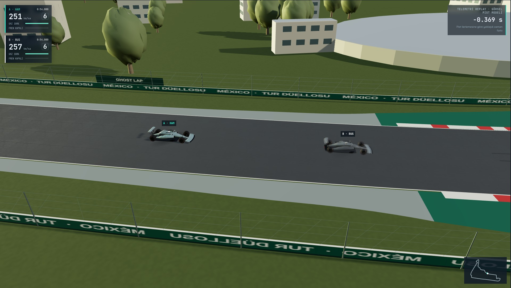](before/07-ghost-comparison.jpg) | [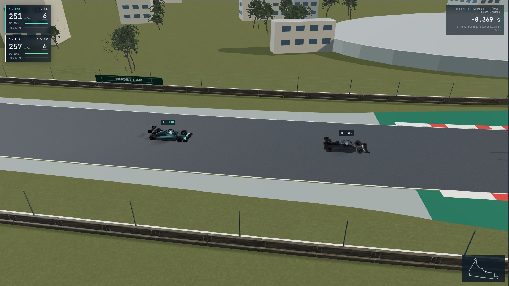](after/07-ghost-comparison.jpg) |
| 08-overview | [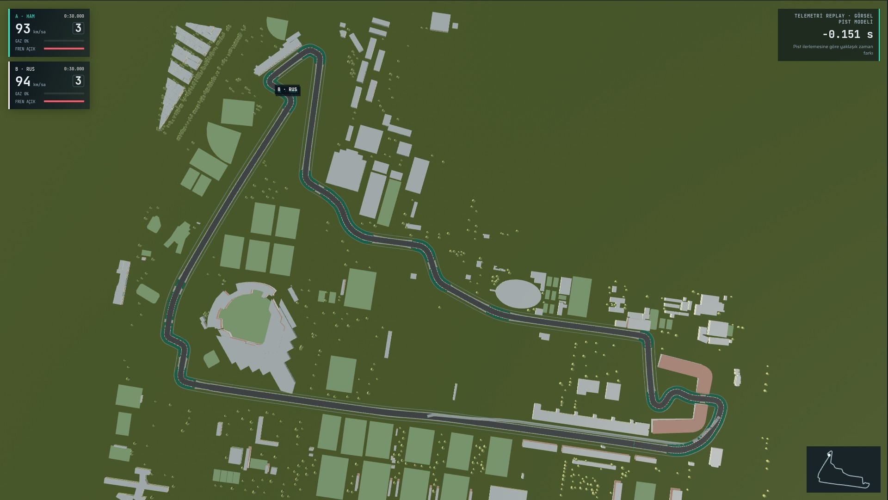](before/08-overview.jpg) | [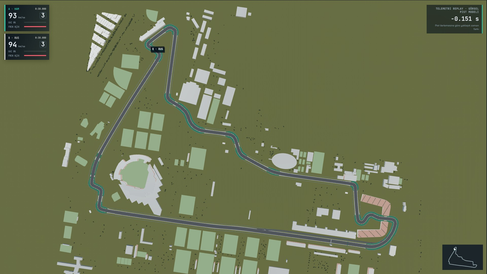](after/08-overview.jpg) |

[Önce metadata](before/captures.json) · [Sonra metadata](after/captures.json) · [Gerçek oynatma videosu](playback.webm) · [Oynatma kaydı](playback.json) · [Native1080p yazılım ölçümü](1080p-software.json)
