# V7 — gerçek uygulamada önce/sonra

Başlangıç: main `e5ffd2224bb3ee2dceed9ee2470bc6f6da33fc74`. Aynı Chromium, viewport, ışık ve kamera ayarları; Ultra, DPR 1, adaptif çözünürlük kapalı. Her pist tam sayfa yüklemesiyle açıldı ve gerçek event/kaynak metadatası doğrulandı. Görseller üretilmiş/retuşlanmış değildir.

Düşük/orta/yüksek LOD aynı açıdan görsel denetim için zorlandı; otomatik mesafe seçimi ayrıca tarayıcı testinde doğrulandı. İki ghost karşılaştırması açıktır; COTA başlangıç yokuşunda HAM/RUS çok yakın olduğundan araçlar örtüşür. Süspansiyon rijittir, banking ölçülmemiştir.

| Görünüm | V6.1 main | V7 |
|---|---|---|
| Ön üç çeyrek · t=50.000 |  |  |
| Yan profil · t=50.000 | [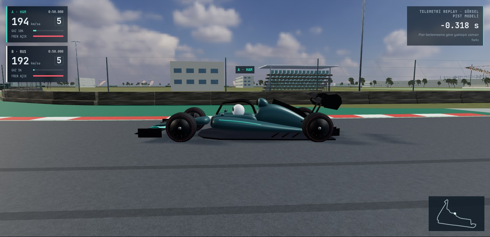](before/02-side-profile.jpg) | [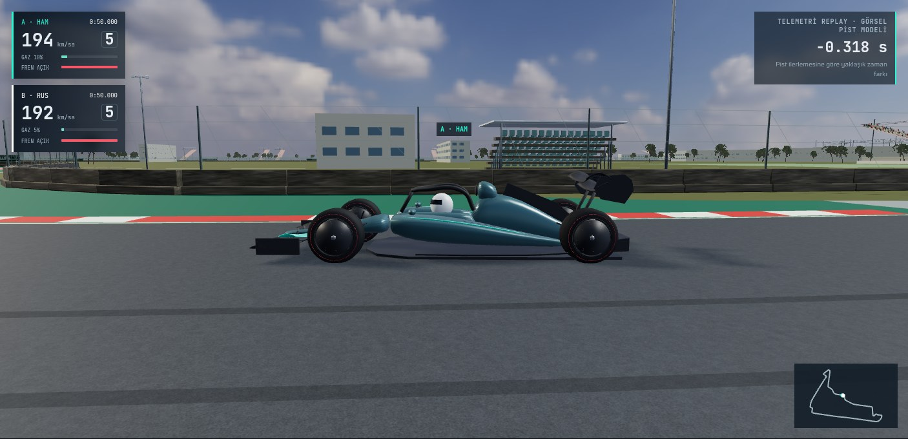](after/02-side-profile.jpg) |
| Arka üç çeyrek · t=50.000 | [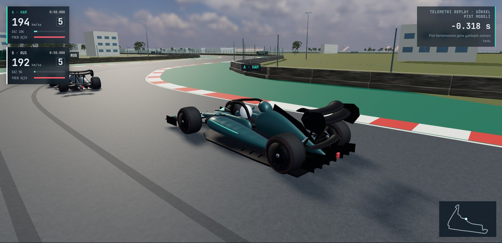](before/03-rear-three-quarter.jpg) | [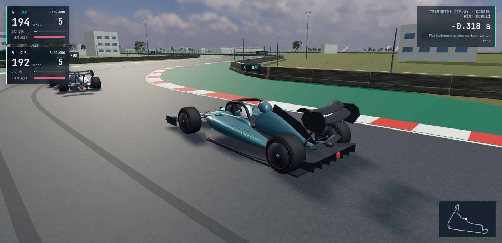](after/03-rear-three-quarter.jpg) |
| Lastik ve süspansiyon · t=50.000 | [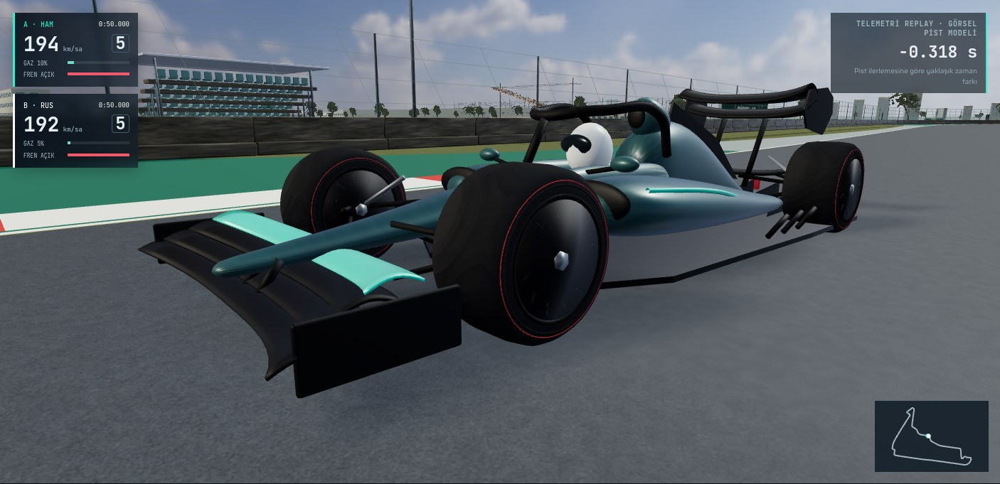](before/04-tyre-suspension.jpg) | [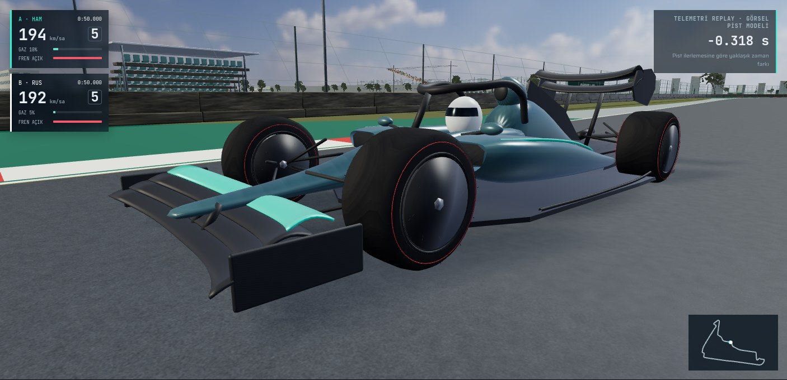](after/04-tyre-suspension.jpg) |
| Kokpit · t=50.000 | [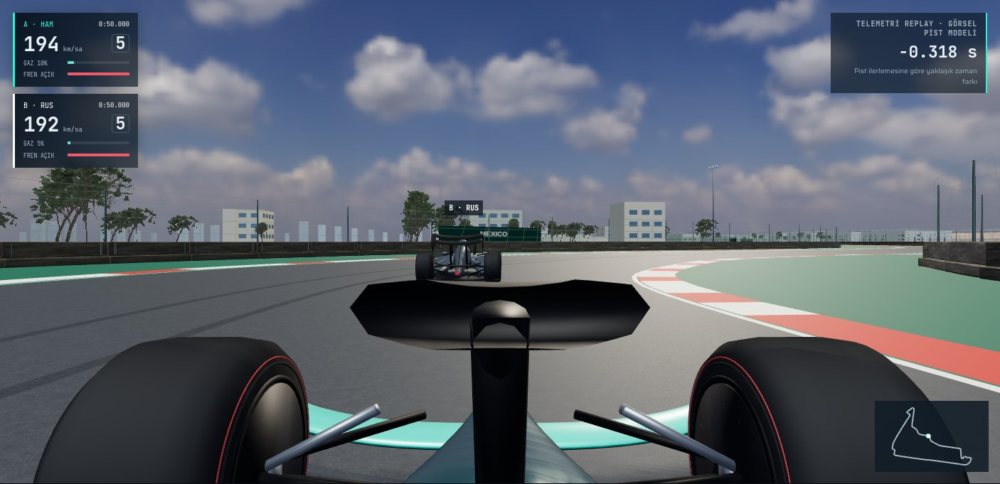](before/05-cockpit.jpg) | [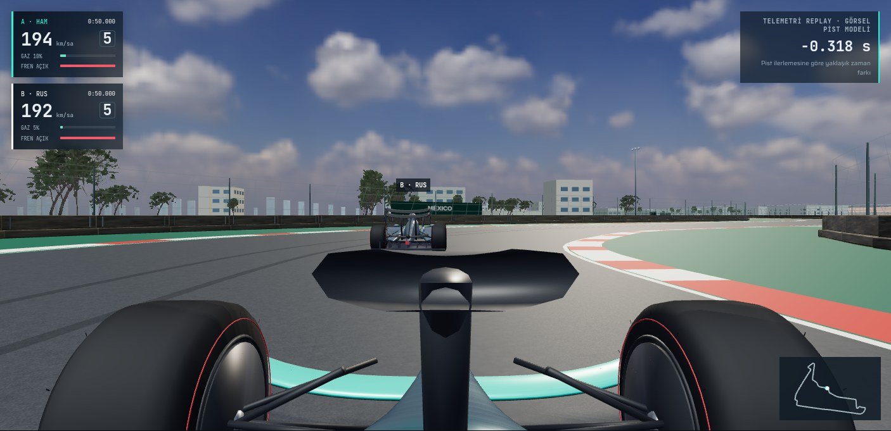](after/05-cockpit.jpg) |
| COTA yokuşu · t=5.975 | [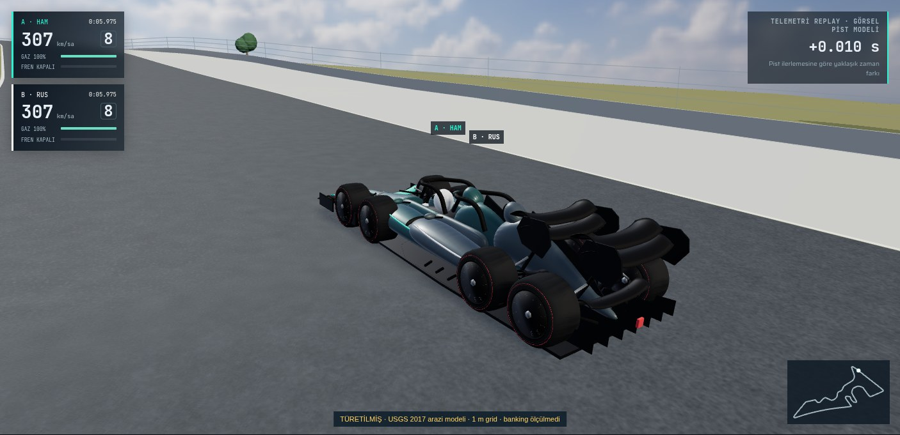](before/06-cota-climb.jpg) | [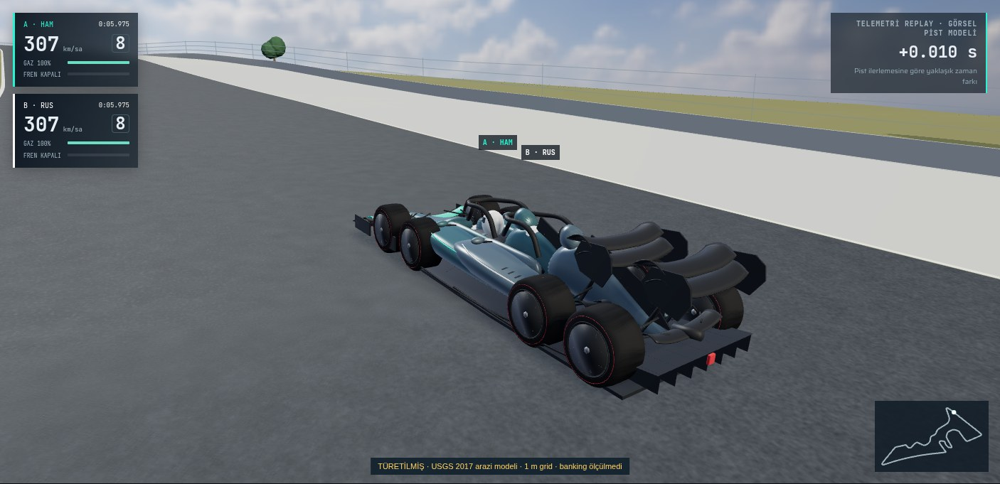](after/06-cota-climb.jpg) |
| Spa Raidillon · t=20.025 | [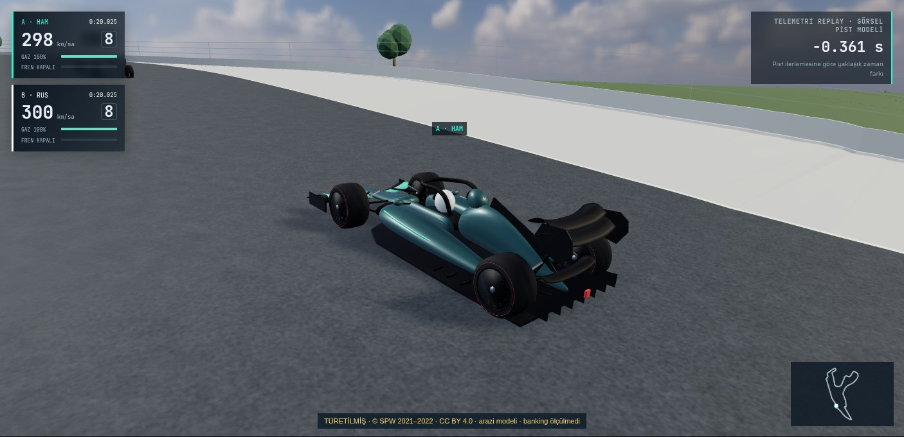](before/07-spa-raidillon.jpg) | [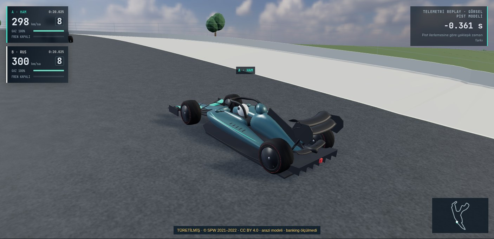](after/07-spa-raidillon.jpg) |
| Düşük LOD · t=50.000 | [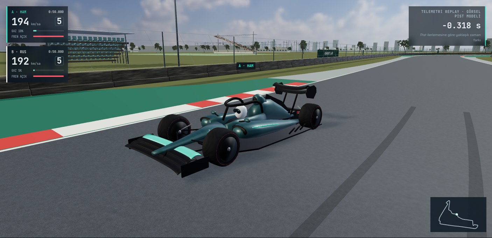](before/08-lod-low.jpg) |  |
| Orta LOD · t=50.000 |  |  |
| Yüksek LOD · t=50.000 | [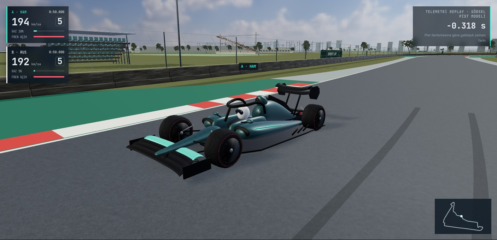](before/10-lod-high.jpg) | [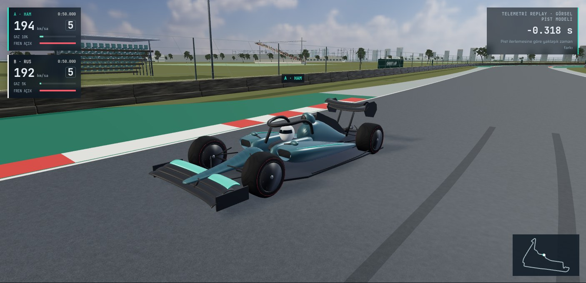](after/10-lod-high.jpg) |
| Takip kamerası · t=50.000 | [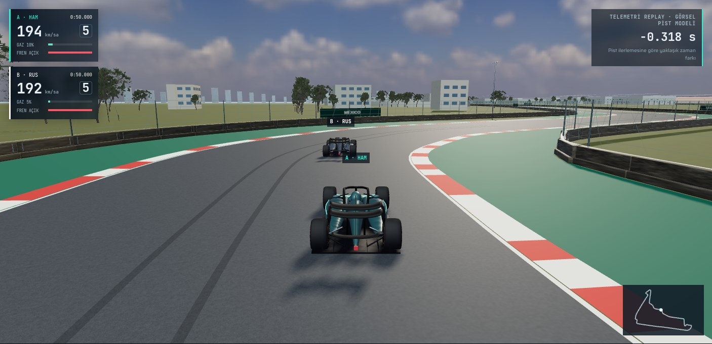](before/11-follow.jpg) | [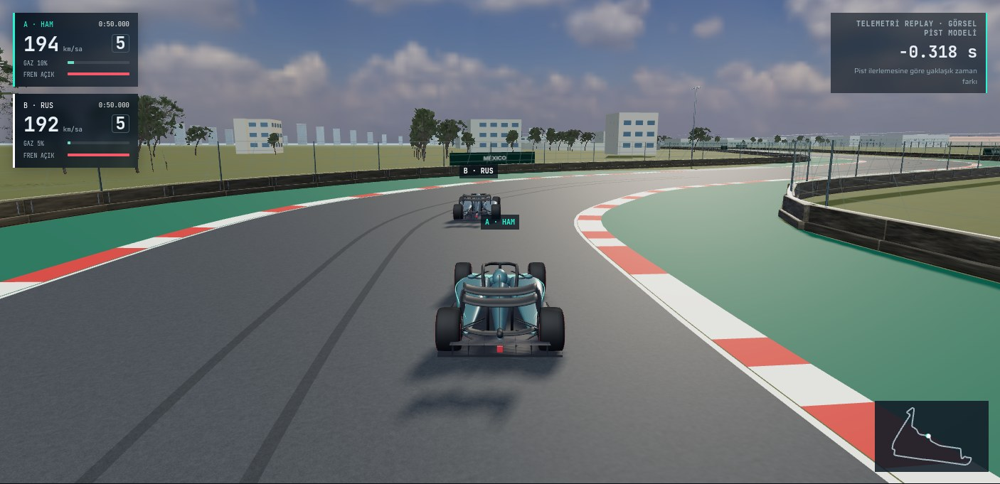](after/11-follow.jpg) |

[Kaynak, kamera, ışık, tampon, sayaç ve temas kayıtları](../../performance/v7/visual-comparison.json) · [JPEG SHA256](image-sha256.json).
