# V7.1 — aynı kamera ve ışıkla gerçek uygulama karşılaştırması

Önce: V8 main `ad35d61f5b26ed1d5ff6d82a3ee43b91478cee94`. Sonra: kullanıcı isteğiyle halosuz V7.1. Kamera konumu, yakın düzlem, görüş açısı, ışık, zaman ve kalite aynı; V8 görsel hareketi/lastik fit sistemi açık. Ultra,1440×1000 viewport, DPR1, adaptif kapalı. Bunlar gerçek Chromium ekran görüntüleridir; üretim/rötuş yoktur.

Düşük/orta/yüksek LOD aynı açıda denetim için zorlanmıştır; otomatik seçim ayrıca mevcut testlerde doğrulanır. COTA başlangıcında iki ghost birbirine yakındır. Yedek karelerinde GLB istekleri bilerek engellenmiştir. Kamera değişikliği teslim edilmedi.

| Görünüm | Önce: V8 main | Sonra: V7.1 |
|---|---|---|
| Ön üç çeyrek · t=50.000 |  |  |
| Yan profil · t=50.000 | [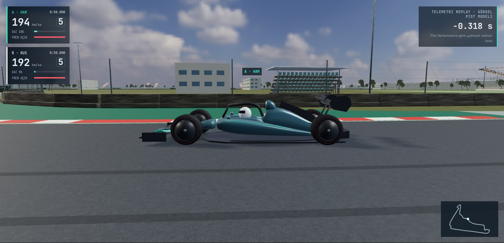](before/02-side-profile.jpg) |  |
| Arka üç çeyrek · t=50.000 |  | [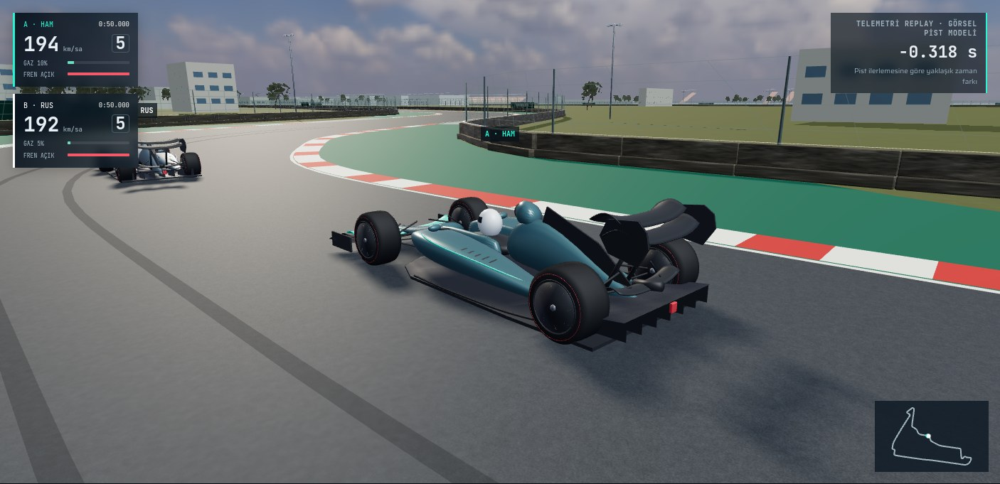](after/03-rear-three-quarter.jpg) |
| Lastik/süspansiyon · t=50.000 |  | [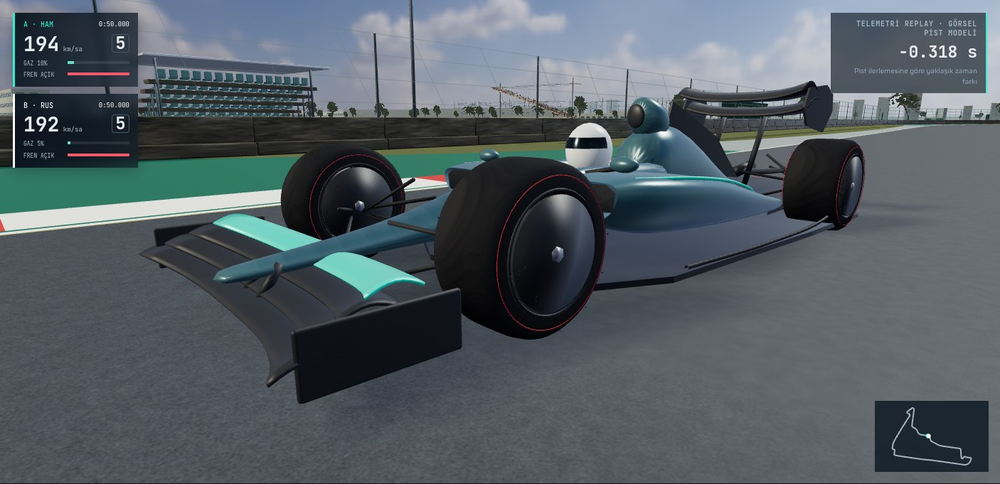](after/04-tyre-suspension.jpg) |
| Meksika kokpit · t=50.000 | [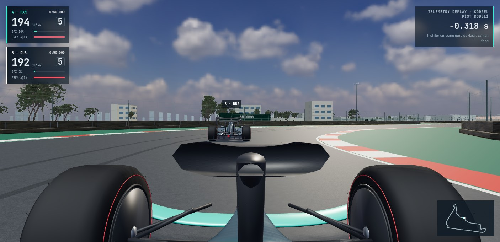](before/05-cockpit.jpg) | [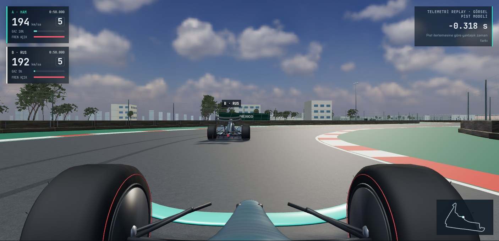](after/05-cockpit.jpg) |
| COTA yokuşu · t=5.975 |  | [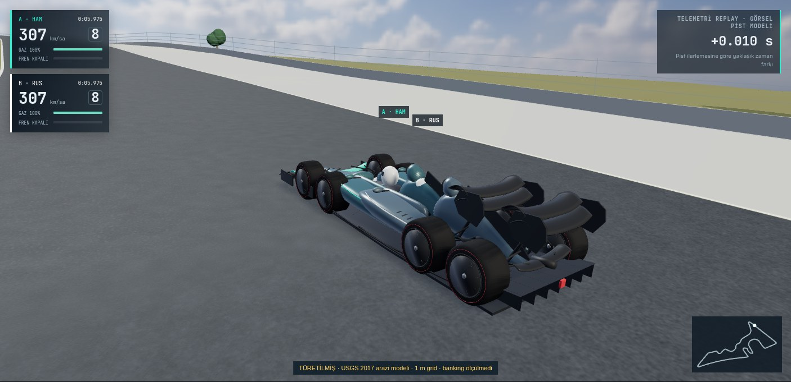](after/06-cota-climb.jpg) |
| COTA kokpit · t=5.975 | [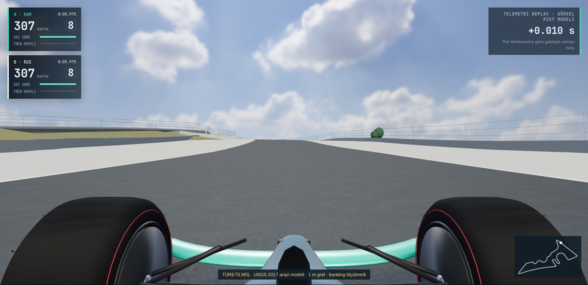](before/12-cota-cockpit.jpg) | [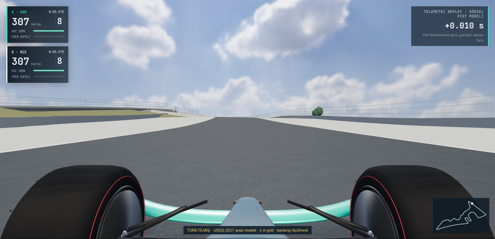](after/12-cota-cockpit.jpg) |
| Spa Raidillon · t=20.025 | [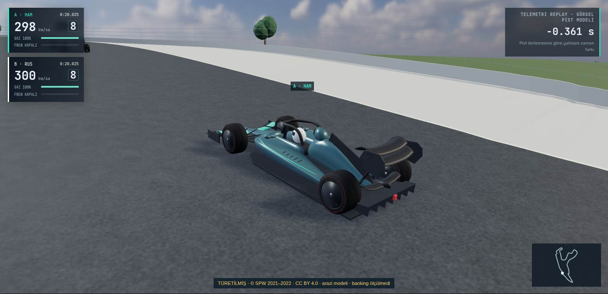](before/07-spa-raidillon.jpg) | [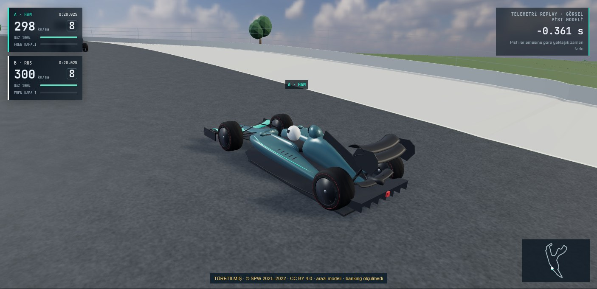](after/07-spa-raidillon.jpg) |
| Spa kokpit · t=20.025 | [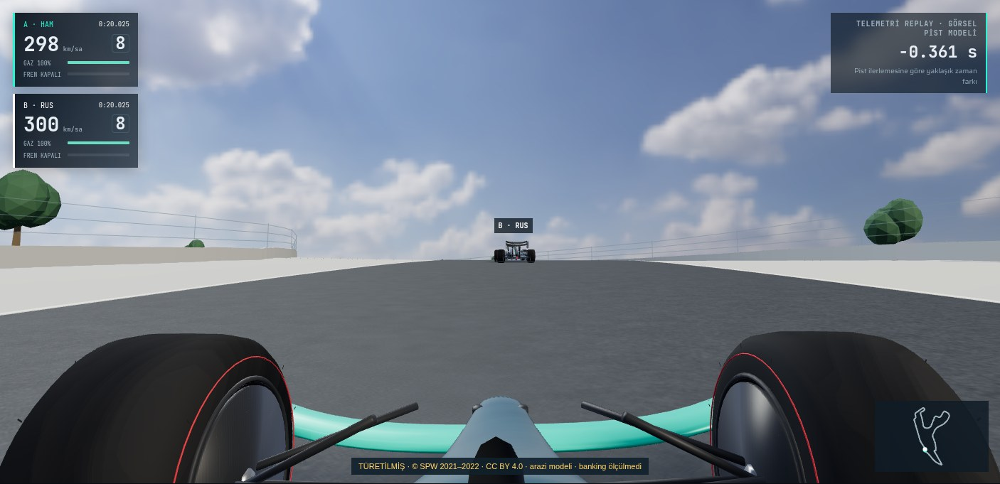](before/13-spa-cockpit.jpg) |  |
| Düşük LOD · t=50.000 |  |  |
| Orta LOD · t=50.000 | [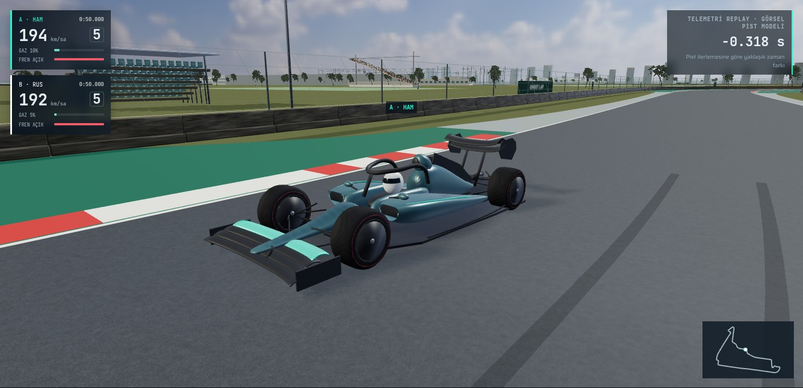](before/09-lod-medium.jpg) |  |
| Yüksek LOD · t=50.000 |  |  |
| Takip · t=50.000 |  | [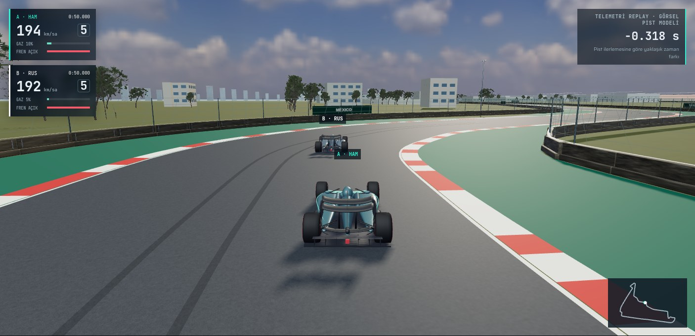](after/11-follow.jpg) |
| Prosedürel yedek: kokpit · t=20 | [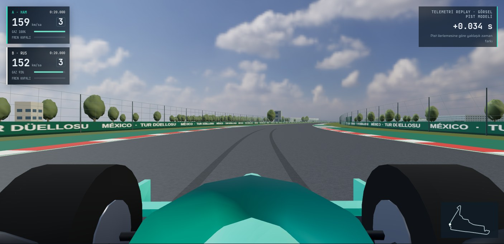](before/fallback-cockpit.jpg) | [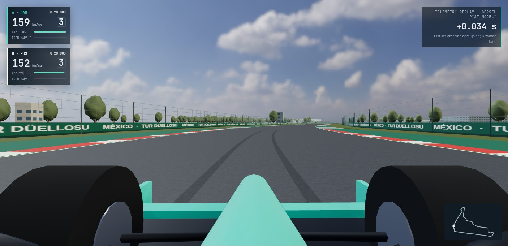](after/fallback-cockpit.jpg) |
| Prosedürel yedek: serbest · t=20 | [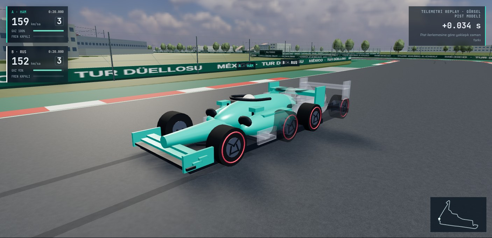](before/fallback-free.jpg) |  |

[Eş kamera/ışık/hareket ve temas kayıtları](../../performance/v71/matched-views.json) · [Yedek kayıtları](../../performance/v71/fallback-views.json) · [JPEG SHA256](image-sha256.json).

[V7 referansı](../v7/README.md): yeni çekilen11 V7 karesinin mevcut dosyalarla byte eşitliği [burada](../../performance/v71/v7-reference.json) doğrulandı.
