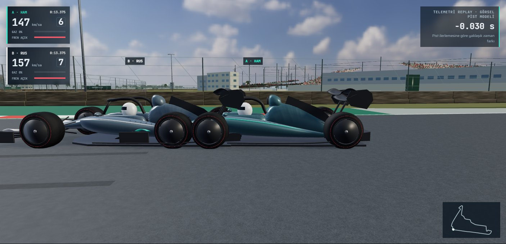
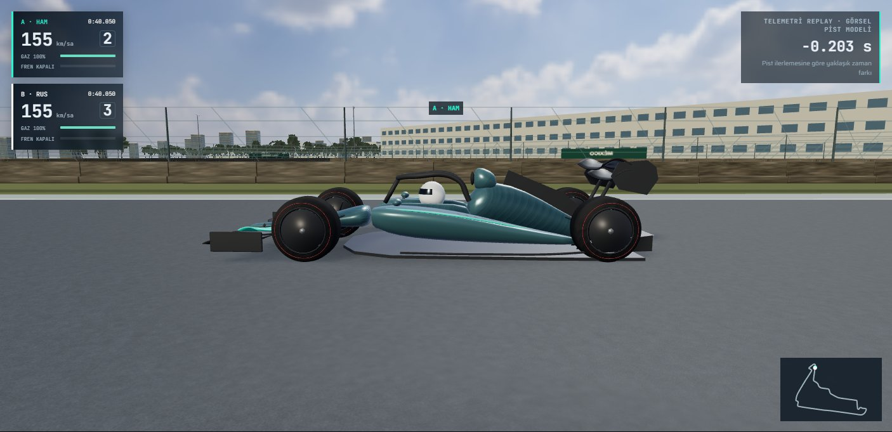
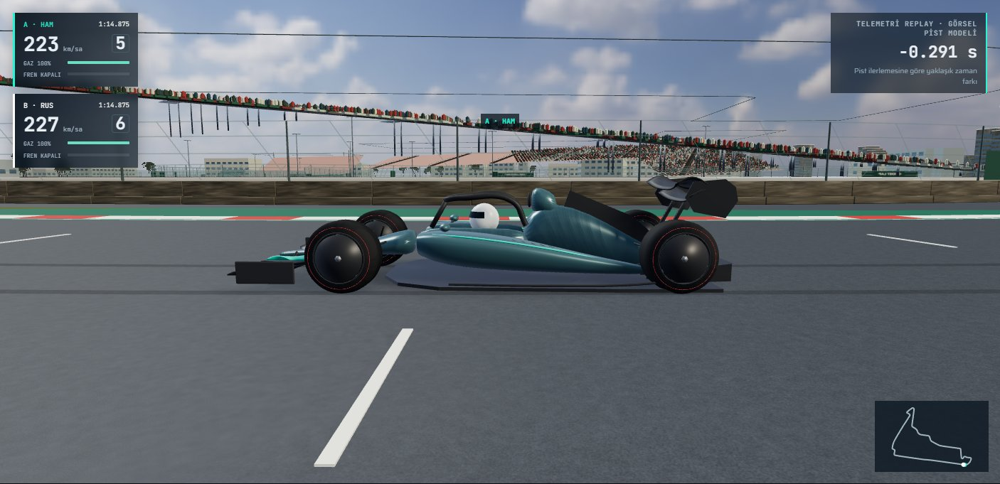
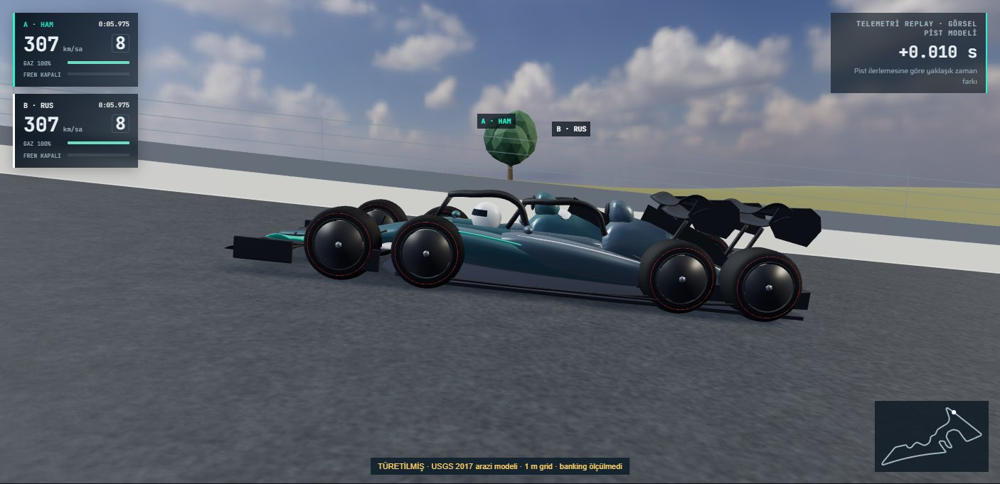
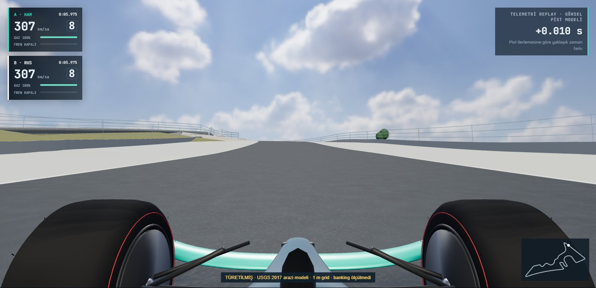
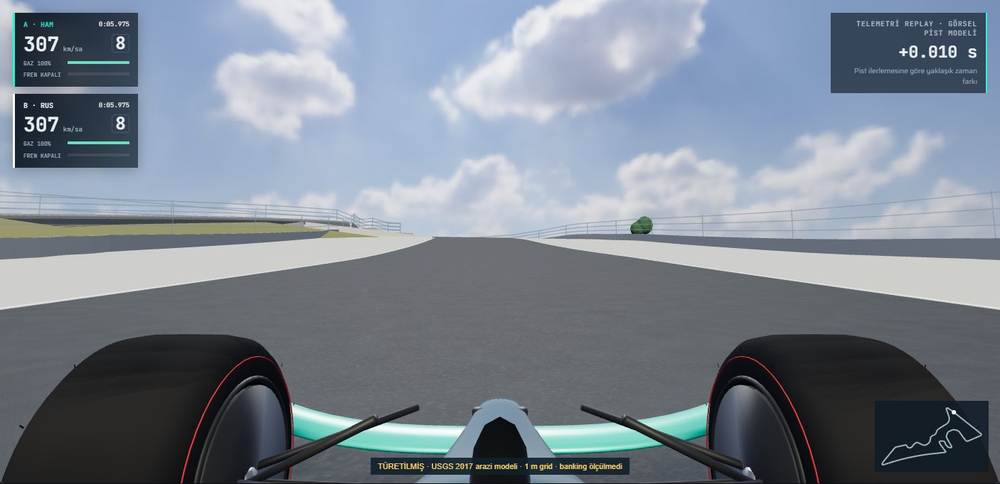
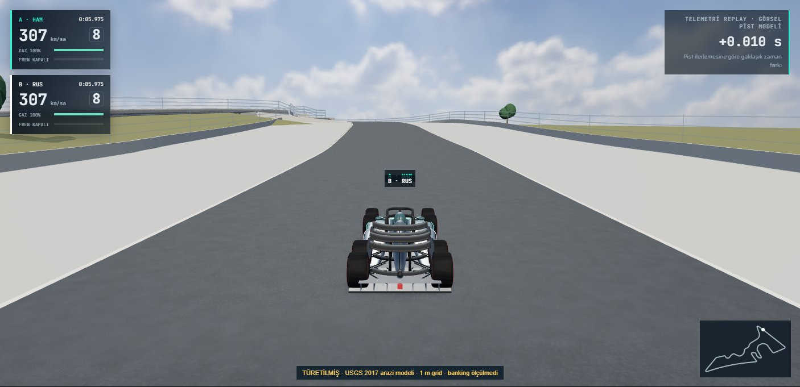
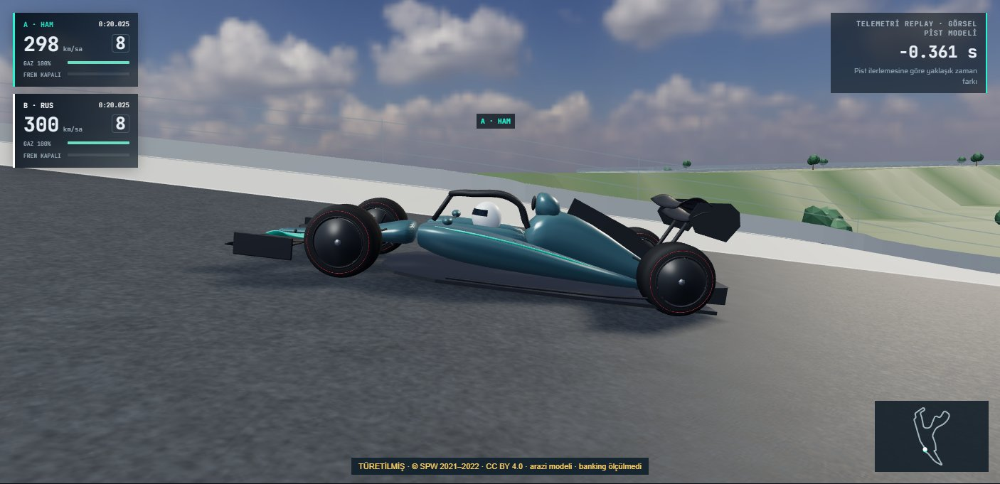
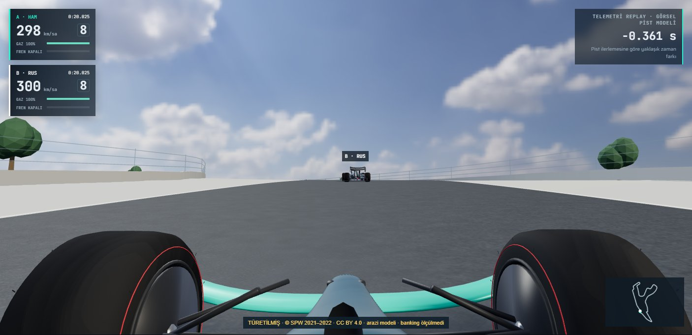
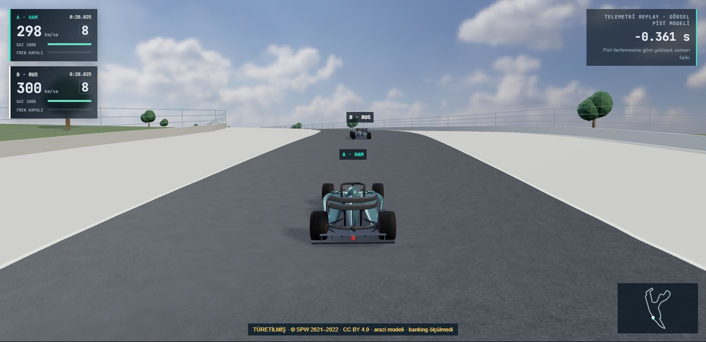

# V8 gerçek uygulama kare dizileri

Önce: V7 main `0d5deec`. Sonra: V8 `c6d0f8f` uygulama kodu. Her sahne için merkez zamanın −0.25 / 0 / +0.25 saniyesinde üç gerçek kare vardır. Kamera, kök telemetri pozu, güneş ve exposure sürümler arasında birebir eşleştirilir. [Ham metadata ve hareket açıları](sequences.json). 1440×1000, DPR 1, Ultra, adaptif çözünürlük kapalı; gerçek Chrome/NVIDIA render'ıdır. Bir FPS karşılaştırması değildir.

Gövde etkisi ±0.5° pitch / ±0.6° roll ile kasıtlı olarak küçüktür; kamera bu görsel salınımı izlememektedir. Tekerlek oturtma görsel yaklaşımdır, ölçülmüş süspansiyon değildir. COTA/Spa yükseltileri ölçülmüş asfalt değil, kaynakları etiketli türetilmiş arazi modelleridir. [Yaklaşım, testler ve açık performans borcu](../../ARAC-HAREKET-V8.md).

| Sahne | V7 merkez kare | V8 merkez kare | Önce dizisi | Sonra dizisi |
|---|---|---|---|---|
| mexico-braking |  |  | [−0.25](before/mexico-braking-0.jpg) · [0](before/mexico-braking-1.jpg) · [+0.25](before/mexico-braking-2.jpg) | [−0.25](after/mexico-braking-0.jpg) · [0](after/mexico-braking-1.jpg) · [+0.25](after/mexico-braking-2.jpg) |
| mexico-acceleration |  |  | [−0.25](before/mexico-acceleration-0.jpg) · [0](before/mexico-acceleration-1.jpg) · [+0.25](before/mexico-acceleration-2.jpg) | [−0.25](after/mexico-acceleration-0.jpg) · [0](after/mexico-acceleration-1.jpg) · [+0.25](after/mexico-acceleration-2.jpg) |
| mexico-corner |  |  | [−0.25](before/mexico-corner-0.jpg) · [0](before/mexico-corner-1.jpg) · [+0.25](before/mexico-corner-2.jpg) | [−0.25](after/mexico-corner-0.jpg) · [0](after/mexico-corner-1.jpg) · [+0.25](after/mexico-corner-2.jpg) |
| cota-grade |  |  | [−0.25](before/cota-grade-0.jpg) · [0](before/cota-grade-1.jpg) · [+0.25](before/cota-grade-2.jpg) | [−0.25](after/cota-grade-0.jpg) · [0](after/cota-grade-1.jpg) · [+0.25](after/cota-grade-2.jpg) |
| cota-cockpit |  |  | [−0.25](before/cota-cockpit-0.jpg) · [0](before/cota-cockpit-1.jpg) · [+0.25](before/cota-cockpit-2.jpg) | [−0.25](after/cota-cockpit-0.jpg) · [0](after/cota-cockpit-1.jpg) · [+0.25](after/cota-cockpit-2.jpg) |
| cota-follow |  |  | [−0.25](before/cota-follow-0.jpg) · [0](before/cota-follow-1.jpg) · [+0.25](before/cota-follow-2.jpg) | [−0.25](after/cota-follow-0.jpg) · [0](after/cota-follow-1.jpg) · [+0.25](after/cota-follow-2.jpg) |
| spa-grade |  |  | [−0.25](before/spa-grade-0.jpg) · [0](before/spa-grade-1.jpg) · [+0.25](before/spa-grade-2.jpg) | [−0.25](after/spa-grade-0.jpg) · [0](after/spa-grade-1.jpg) · [+0.25](after/spa-grade-2.jpg) |
| spa-cockpit |  |  | [−0.25](before/spa-cockpit-0.jpg) · [0](before/spa-cockpit-1.jpg) · [+0.25](before/spa-cockpit-2.jpg) | [−0.25](after/spa-cockpit-0.jpg) · [0](after/spa-cockpit-1.jpg) · [+0.25](after/spa-cockpit-2.jpg) |
| spa-follow |  |  | [−0.25](before/spa-follow-0.jpg) · [0](before/spa-follow-1.jpg) · [+0.25](before/spa-follow-2.jpg) | [−0.25](after/spa-follow-0.jpg) · [0](after/spa-follow-1.jpg) · [+0.25](after/spa-follow-2.jpg) |
